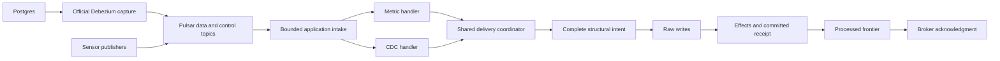

# Application-owned CDC integration assessment

November 4, 2026 UTC. **Recommendation: proceed to a bounded qualification,
not adoption or a full CDC implementation yet.** No released-client API blocker
was found for this shape. The application can receive native delivery metadata
and explicitly sequence its writes. The difficult source, bootstrap, coverage,
erasure and resource contracts still need executable proof.

The user authorized this assessment as an exception to the previous
no-custom-consumer constraint. Pulsar, Debezium capture, the existing server and
official clients remain fixed. This assessment adds no ETL framework or queue,
does not authorize production changes and does not retire PeerDB. The
[SeaTunnel](pulsar-cdc-assessment.md#native-cdc-effect-identity-confirmed-connector-blocker)
and [Flink](flink-cdc-assessment.md) findings remain unchanged.

## Proposed shape and actual implementation state

This is a proposed application flow, not a diagram of deployed functionality.
Production still uses the Kafka application consumer and PeerDB. Typed native
positions, journal/receipt and finite-frontier primitives exist, but
`pulsar-consumer.ts` and a CDC handler do not. Structural-history, preparation and
query-owner code is partial, uncommitted work with remaining exact-tree and
review gates. A position codec is not a qualified native sink.

Use one mandatory delivery-coordinator implementation with distinct metric and
CDC handlers, not a second orchestration framework or an optional no-journal
branch. “One intake” does not require one consumer object or invent a total order
across topics. Control/dependency inputs must remain able to progress while a
data delivery waits, with bounded native queues and application state.

## Native client and capture capabilities

The current official Node client is 1.18.0, using the independently versioned
C++ client 4.2.0. Both are current in the [Apache client inventory](https://pulsar.apache.org/download/)
and [Node release](https://github.com/apache/pulsar-client-node/releases/tag/v1.18.0).
These are not the old Java client artifact found in the Flink assessment.
The [native API](https://github.com/apache/pulsar-client-node/blob/v1.18.0/index.d.ts)
provides payload, key, properties, topic and serialized message ID together,
plus explicit acknowledgments and finite receive-queue controls. The application
can preserve that identity before decoding instead of losing it at an ETL row
boundary. Earlier real native tests established batch/ledger ID round-trips;
they did not test CDC semantics or the full application image/TLS path.

Debezium Server 3.7.0.Final can send the unchanged envelope through its official
[Pulsar sink](https://github.com/debezium/debezium-server/blob/v3.7.0.Final/debezium-server-pulsar/src/main/java/io/debezium/server/pulsar/PulsarChangeConsumer.java).
Do not flatten away structural before images. Require and test the necessary
PostgreSQL replica identity, original keys, nulls and unchanged external text;
an unavailable-value placeholder must not become null or an out-of-band current
database value. [PostgreSQL capture reference](https://debezium.io/documentation/reference/3.7/connectors/postgresql.html).

Transport identity and source revision are separate: a source restart may
republish the same change with a new native message ID. Both deliveries need
receipts, but must converge to the same source revision and effects.

## Source ordering: a candidate requiring live proof

Two shortcuts are unsound:

- Full `transaction.id` string equality does not group every PostgreSQL record.
  Debezium appends the current LSN on each call, including BEGIN and END.
  [Released transaction monitor](https://github.com/debezium/debezium/blob/v3.7.0.Final/debezium-connector-postgres/src/main/java/io/debezium/connector/postgresql/pipeline/txmetadata/PostgresTransactionMonitor.java#L34-L65).
- Row LSN alone is not a unique change ordinal. The source keeps a per-LSN event
  counter for multiple records sharing one position.
  [Released offset context](https://github.com/debezium/debezium/blob/v3.7.0.Final/debezium-connector-postgres/src/main/java/io/debezium/connector/postgresql/PostgresOffsetContext.java).

A candidate streaming revision is a validated capture generation, stream phase,
transaction END coordinate and emitted `transaction.total_order`. This is a
source-code inference, not a qualified encoding for the existing raw version
column. Preserve original values and parse 64-bit numbers losslessly, including
Java signed-long representation of LSNs. Do not use wall clocks, broker arrival
order or UUID lexical order as source precedence.

The END-coordinate derivation spans PostgreSQL, its JDBC replication driver and
Debezium. Compare actual emitted values with native PostgreSQL transaction/WAL
evidence before accepting it. Group raw transaction IDs only within a proven
lineage/incarnation; absent or ambiguous associations block publication.
[PostgreSQL commit callback](https://github.com/postgres/postgres/blob/REL_18_3/src/backend/replication/logical/logical.c#L867-L893),
[replication driver](https://github.com/pgjdbc/pgjdbc/blob/REL42.7.13/pgjdbc/src/main/java/org/postgresql/core/v3/replication/V3PGReplicationStream.java#L265-L283).

An independently consumed, non-partitioned transaction-control topic can provide
ordered control evidence without buffering all row values in memory. END arrival
is not completion: validate the unique emitted ordinal set and per-table counts
against durable mapping receipts. A marker requires the covered transaction
prefix, not only its own transaction or a maximum LSN. Missing data must not
deadlock the only loop capable of receiving that data. [Transaction metadata](https://debezium.io/documentation/reference/3.7/connectors/postgresql.html#postgresql-transaction-metadata),
[Pulsar topic administration](https://pulsar.apache.org/docs/5.0.x/admin-api-topics/).

## Bootstrap: native evidence exists, automatic correlation does not

Released sink notifications can reach Pulsar through the normal source-record
path. Initial snapshot notifications include resolved table inventory,
per-table success/counts, including empty tables, and final completion.
However, each notification gets a fresh UUID; its value has no shared snapshot
attempt ID or source offset. Notifications alone cannot associate delayed data
with the correct restarted attempt.
[Sink notification channel](https://github.com/debezium/debezium/blob/v3.7.0.Final/debezium-connector-common/src/main/java/io/debezium/pipeline/notification/channels/SinkNotificationChannel.java#L85-L118),
[initial notification builder](https://github.com/debezium/debezium/blob/v3.7.0.Final/debezium-connector-common/src/main/java/io/debezium/pipeline/notification/InitialSnapshotNotificationService.java).

A candidate qualification strategy is one fenced operator-controlled attempt
with a dedicated native topic/notification prefix and offset-store identity.
Any pre-completion crash aborts that attempt; a new attempt must not merge its
inventory with the abandoned one. Native `initial_only` can bound capture, but
does not prove row coverage or safe transition to streaming. That transition,
including slot/offset continuity, needs its own test. This lifecycle has not been
selected for production and requires alignment before qualification. All failed
attempt data also belongs in retention, erasure and capacity accounting.
[Initial-only snapshotter](https://github.com/debezium/debezium/blob/v3.7.0.Final/debezium-connector-common/src/main/java/io/debezium/snapshot/mode/InitialOnlySnapshotter.java).

## Actual application work and migration surface

The current [mirror contracts](../src/db/peerdb/mirror-contracts.ts) contain
**18 destinations total: 15 data destinations plus three marker destinations,
from 16 unique PostgreSQL source tables**. This is not 18 data tables plus markers.

| Domain | Current data sources; marker fan-out |
| --- | --- |
| Fitness | activity, sleep_session, sleep_stage, daily_metrics, provider, provider_connection, provider_priority, provider_field_priority, device_priority, user_profile; fitness marker destination |
| Inventory | food_entry, health_event, clinical_record; inventory marker destination |
| Sensor priority | sensor_provider_priority, sensor_device_priority; sensor-priority marker destination |

All three markers originate from processing_flow_marker. The current reconciler
reads fitness/inventory markers but not the sensor-priority destination. The
replacement completion contract must cover actual dependencies in all three.

Necessary new application work includes typed CDC keys and ownership, not fake
sensor UUIDs: keys can be UUID, string or composite; ownership can be direct,
inherited or shared. The current sensor effect type cannot represent these
unchanged. Inherited ownership must survive parent deletion and erasure; its
durable resolution is a qualification gate, not an after-the-fact database read.

Preserve the canonical [raw schemas](../src/db/clickhouse-raw-tables.ts), exact
column exclusions and nullable semantics. Mutating a ClickHouse sorting-key
field requires retracting the former full key; `FINAL` does not merge different
sorting identities. Existing `_peerdb_version` values and new revision encodings
cannot be assumed comparable. Choose one reviewed canonical migration; do not
add permanent dual writers, duplicate values or compatibility columns.
[ReplacingMergeTree](https://clickhouse.com/docs/engines/table-engines/mergetree-family/replacingmergetree).

Also required: native intake/readiness, all sink mutation/receipt wiring,
schema validation, transaction and stage coverage, erasure writer barriers,
operator recovery, health/deploy tooling and removal of obsolete PeerDB runtime
dependencies only at verified cutover. Retain the existing SQL ownership and
serialized analytics queue. Unknown schema, missing WAL, unsupported operations
or incomplete evidence must fail visibly without acknowledging success.

## Resource and remaining safety gates

No extra ETL JVM is required by this shape. That is not a memory-fit result:
consumer multiplicity, queues, parsing, transaction manifests and mixed workload
must be measured under finite caps. The unchanged whole-host allocation still
fails; no lower production ClickHouse ceiling or aggregate warm-host soak has
passed. Native large/chunked messages remain a separate qualification boundary.

Keep Q7 fail-closed recovery for uncertain executors; a released session lock is
not proof that an old query cannot write. New structural/control state must join
the existing account-erasure inventory and physical expiry proofs. Preserve all
original R2 data and job/checkpoint windows. Full legacy archive conversion,
restore/rollback and all four production-hold restoration gates remain required.
No hold was restored by this assessment.

## Recommended next qualification

Run a small isolated source-contract spike before building the full CDC handler:

1. Capture unchanged envelopes and native IDs for two changed tables, an empty
   table and a processing marker. Check full before/after data, null/microsecond
   timestamps, external text, a primary-key split and exact transaction counts.
2. Establish real same-LSN cases and compare END/ordinal revisions through offset
   flush, capture termination and replay. Include overlapping transactions and
   delayed older deliveries; stop if association or ordering is ambiguous.
3. Verify notification inventory and empty-table evidence, then interrupt an
   attempt and prove its rows cannot contaminate the accepted attempt. Separately
   prove snapshot-to-stream continuity; do not infer readiness from process exit.

Only after those pass should a metric/activity/marker sink slice prove each
prepare/raw/effect/receipt/frontier/ACK crash boundary, delayed marker coverage
and erasure. Full 16-source/18-destination mapping, inherited/shared ownership,
schema/WAL loss, all marker domains and full-host qualification follow. This is
a proposed qualification, not executed evidence or implementation approval.

Retrospective: source and code inventory checks found transaction-ID drift,
missing attempt identity, sensor-specific types and a marker coverage gap before
another implementation. Add a source/transport/snapshot identity matrix and
explicit mapping-count/ownership inventory to preflight guidance. Reuse native
source review and real-engine integration tests; no new capture framework or
broker is needed for this candidate assessment.
