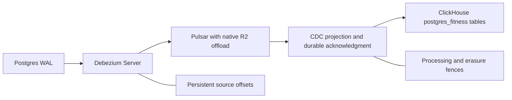

# Pulsar CDC consolidation assessment — 2026-11-03

**Assessment result: capture is feasible; replacing PeerDB is not yet qualified.**
The user approved assessing this architecture change. No production publication,
replication slot, PeerDB service, schema, or writer was changed. The current
[design](superpowers/specs/2026-11-03-single-server-pulsar-design.md) retains
PeerDB until a revised design is approved and its replacement passes the gates
below. Existing R2 archive conversion remains mandatory and independent of CDC.

## Candidate and isolated proof

Debezium Server has an official native Pulsar sink, so capture does not require
Kafka, Kafka Connect, or an additional Pulsar Functions worker. The proposed
capture source is PostgreSQL's built-in `pgoutput`:
[Debezium Server](https://debezium.io/documentation/reference/3.7/operations/debezium-server.html),
[PostgreSQL connector](https://debezium.io/documentation/reference/3.7/connectors/postgresql.html).

The isolated ARM64 fixture used the released Debezium 3.7.0.Final image,
`quay.io/debezium/server@sha256:99a45f62b166bc02de9a2d935e80916da46ab256a2338e1c5da4ffe235060f6b`,
a separate PostgreSQL 18.3 database and slot, and the qualification Pulsar broker.
It used synthetic data only, no published host ports, and persisted the source
offset file in a named volume. Debezium's container uses
`/debezium/config/application.properties`, not `/debezium/conf/`.

| Exercise | Observed result |
| --- | --- |
| Initial snapshot | 1,000 distinct rows verified from Pulsar, including null timestamps, text arrays, and 6,400-character text fields. |
| Committed transaction | Update, delete and insert verified; delete carried the primary key and null `after`; events included source LSNs. |
| Abrupt source termination | Source killed after its offset file existed; another insert committed while it was stopped. Restart loaded the previous offset, skipped the completed snapshot, and delivered that insert. |
| Resource bound | Source capped at 512 MiB / 0.5 CPU, heap 256 MiB / direct memory 64 MiB; final cgroup peak 420,229,120 bytes, `max=0`, `oom=0`, `oom_kill=0` in the restarted process. Earlier initial snapshot peak was 385,601,536 bytes after configuration correction. |

This is a capture/restart fixture, not a ClickHouse sink test, a complete crash
matrix, a production peak measurement, or an exactly-once claim. The first
snapshot attempt failed explicitly because Pulsar's producer configuration
required `maxPendingMessagesAcrossPartitions >= maxPendingMessages`. Setting both
to 1 corrected that prerequisite; no retry/deadline was raised. A consumer
started before the corrected source had completed startup hit its unchanged
10-second receive deadline; after logs confirmed snapshot completion, it read
all 1,000 retained records. Both failures remain part of the evidence.

The restart logs also exposed the source default `offset.mismatch.strategy` as
`no_validation`. Slot loss/recreation handling must be explicitly qualified;
the successful same-slot restart does not certify that failure case. Debezium
documents slot/WAL recovery and duplicate-delivery concerns in its
[PostgreSQL connector reference](https://debezium.io/documentation/reference/3.7/connectors/postgresql.html).

## Scope that must survive retirement

The current [mirror contracts](../src/db/peerdb/mirror-contracts.ts) describe
**16 unique PostgreSQL sources, 18 destination mappings, nine excluded columns,
and three processing-marker destinations**. The repeated source is
`fitness.processing_flow_marker`. This is not a migration of all 105 ClickHouse
tables; derived analytics and other ingestion tables have different owners.

Required behavior includes:

- All three mirror groups and destination names; nullable activity `ended_at`;
  excluded sleep calculations and daily-metric fields, including provider energy
  estimates. Capture/projection must not silently restore those excluded fields.
- Snapshot-to-WAL continuity, deterministic row versions, deletes, key changes,
  duplicate replay and unchanged TOAST values. Source LSN alone needs an explicit
  tie/order rule for multiple changes in a transaction; wall-clock timestamps are
  insufficient. The documented source semantics are in the
  [PostgreSQL connector reference](https://debezium.io/documentation/reference/3.7/connectors/postgresql.html).
- Processing markers must become visible only after their covered writes are
  durable in ClickHouse. Per-table topics alone do not establish cross-table
  completion. A reviewed ordering/barrier design and executable tests are required.
- The current [account-erasure writer barrier](../src/account-erasure/peerdb-staging-writer-barrier.ts)
  discovers, quiesces and verifies writers, captures a sealed staging inventory,
  and persists resumable boundary progress. The replacement must cover source
  snapshots, Pulsar ledgers, offloaded objects, consumers, offset backups and
  restores. Deleting a current ClickHouse row does not erase historical messages.
- Postgres WAL needs its own physical capacity boundary when capture or Pulsar
  is unavailable. Offloading Pulsar does not bound a replication slot's retained
  WAL. Slot invalidation must fail visibly and require a reconciled rebootstrap;
  an empty resnapshot cannot silently account for historical deletes.

## Off-the-shelf consumer findings

Apache's generic JDBC ClickHouse sink is not a drop-in PeerDB replacement. Its
current implementation explicitly rejects arrays, and the generic JDBC guide
does not give ClickHouse the supported databases' idempotent UPSERT path:
[connector source](https://github.com/apache/pulsar-connectors/blob/master/jdbc/clickhouse/src/main/java/org/apache/pulsar/io/jdbc/ClickHouseJdbcAutoSchemaSink.java),
[JDBC sink reference](https://pulsar.apache.org/docs/5.0.x/io-jdbc-sink/).
The fixture therefore validates capture only; it does not establish that this
connector can satisfy the application contracts.

SeaTunnel has both a Pulsar source and a CDC-capable ClickHouse sink. Its
ClickHouse connector documents primary-key upsert/delete options and dependence
on a suitable deduplicating table engine. It remains a possible off-the-shelf
consumer to qualify, not a proven incompatible product or an approved new
runtime. Memory, Debezium envelope/type mapping, marker ordering and erasure
fences were not tested here:
[Pulsar source](https://seatunnel.apache.org/docs/2.3.12/connector-v2/source/Pulsar/),
[ClickHouse sink](https://seatunnel.apache.org/docs/2.3.12/connector-v2/sink/Clickhouse/).
Do not introduce a custom CDC consumer merely because the capture fixture passes;
the user's preference for established integrations still applies.

## Whole-host budget

The current proposed Pulsar topology with PeerDB retained totals **24,568 MiB of
capped services**, versus about **23,975 MiB physical RAM**, before presently
uncapped processes and OS reserve. The retiring PeerDB group plus `cdc-health`
has these configured ceilings:

| Service | MiB |
| --- | ---: |
| PeerDB | 128 |
| Catalog | 256 |
| Flow API | 256 |
| Snapshot worker | 512 |
| Flow worker | 2,048 |
| MinIO staging | 512 |
| MinIO lifecycle | 128 |
| Temporal | 400 |
| Temporal admin tools | 64 |
| CDC health | 200 |
| **Total** | **4,504** |

Subtracting that group and adding a 512 MiB capture source leaves **20,576 MiB**
before a replacement CDC sink, currently uncapped processes, OS reserve,
migration overlap and archive conversion. This is potential ceiling reduction,
not measured freed resident RAM. Redis alone has a recorded `used_memory_peak`
of 2,996,626,848 bytes (about 2,858 MiB), so treating its present idle usage as
its budget would erase most apparent headroom. Successful production
`deduped_sensor` queries also reached 9,467,386,212 bytes of query memory; the
ClickHouse cap cannot be cut on the strength of idle RSS.

**Recommendation:** carry Debezium Server forward as a qualified capture
candidate, but do not retire PeerDB or claim the existing-server memory gate
passed. First select and prove an established CDC consumer against the complete
contract, then demonstrate the combined resource budget with host reserve,
bounded WAL, conversion and a safe cutover overlap. Any revised implementation
plan must explicitly preserve the erasure/restore barriers and obtain approval
before changing the approved retained-PeerDB architecture.

## Retrospective

Testing the smallest native capture topology produced useful evidence without
touching production. The important distinction was transport support versus
application-compatible projection. Future runbooks should inventory CDC contracts
and budget every replacement service before treating retired service ceilings
as available memory. Use the systematic-debugging and real-database integration
workflows for the remaining sink and recovery cases.
