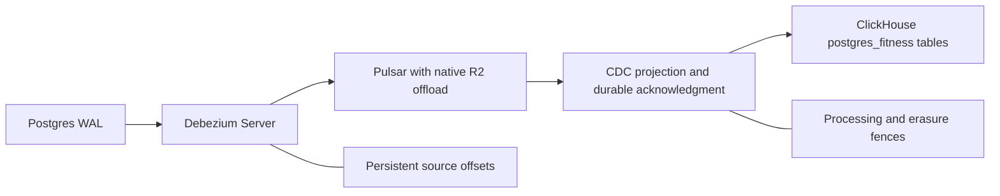

# Pulsar CDC consolidation assessment and qualification — 2026-11-03

**Assessment result: capture is feasible; replacing PeerDB is not yet qualified.**
The user approved assessing this architecture change. No production publication,
replication slot, PeerDB service, schema, or writer was changed. The current
[design](superpowers/specs/2026-11-03-single-server-pulsar-design.md) retains
PeerDB until a revised design is approved and its replacement passes the gates
below. Existing R2 archive conversion remains mandatory and independent of CDC.

The user subsequently requested qualification. The bounded follow-up results
are recorded below. **The current candidate does not pass production
qualification:** its complete resource allocation does not fit and application
erasure/marker contracts are not yet proven. The timestamp failure on the
production-version engine was subsequently isolated and the bounded temporal
gate passed on ClickHouse 26.10.2.103, as recorded below. Production remains on
its existing version. Positive controls are identified separately from the
remaining gates.

## Candidate and isolated proof



Debezium Server has an official native Pulsar sink, so capture does not require
Kafka, Kafka Connect, or an additional Pulsar Functions worker. The proposed
capture source is PostgreSQL's built-in `pgoutput`:
[Debezium Server](https://debezium.io/documentation/reference/3.7/operations/debezium-server.html),
[PostgreSQL connector](https://debezium.io/documentation/reference/3.7/connectors/postgresql.html).

The isolated ARM64 fixture used the released Debezium 3.7.0.Final image,
`quay.io/debezium/server@sha256:99a45f62b166bc02de9a2d935e80916da46ab256a2338e1c5da4ffe235060f6b`,
a separate PostgreSQL 18.3 database and slot, and the qualification Pulsar broker.
It used synthetic data only, no published host ports, and persisted the source
offset file in a named volume. Debezium's container uses
`/debezium/config/application.properties`, not `/debezium/conf/`.

| Exercise | Observed result |
| --- | --- |
| Initial snapshot | 1,000 distinct rows verified from Pulsar, including null timestamps, text arrays, and 6,400-character text fields. |
| Committed transaction | Update, delete and insert verified; delete carried the primary key and null `after`; events included source LSNs. |
| Abrupt source termination | Source killed after its offset file existed; another insert committed while it was stopped. Restart loaded the previous offset, skipped the completed snapshot, and delivered that insert. |
| Resource bound | Source capped at 512 MiB / 0.5 CPU, heap 256 MiB / direct memory 64 MiB; final cgroup peak 420,229,120 bytes, `max=0`, `oom=0`, `oom_kill=0` in the restarted process. Earlier initial snapshot peak was 385,601,536 bytes after configuration correction. |

This is a capture/restart fixture, not a ClickHouse sink test, a complete crash
matrix, a production peak measurement, or an exactly-once claim. The first
snapshot attempt failed explicitly because Pulsar's producer configuration
required `maxPendingMessagesAcrossPartitions >= maxPendingMessages`. Setting both
to 1 corrected that prerequisite; no retry/deadline was raised. A consumer
started before the corrected source had completed startup hit its unchanged
10-second receive deadline; after logs confirmed snapshot completion, it read
all 1,000 retained records. Both failures remain part of the evidence.

The restart logs also exposed the source default `offset.mismatch.strategy` as
`no_validation`. Slot loss/recreation handling must be explicitly qualified;
the successful same-slot restart does not certify that failure case. Debezium
documents slot/WAL recovery and duplicate-delivery concerns in its
[PostgreSQL connector reference](https://debezium.io/documentation/reference/3.7/connectors/postgresql.html).

## Scope that must survive retirement

The current [mirror contracts](../src/db/peerdb/mirror-contracts.ts) describe
**16 unique PostgreSQL sources, 18 destination mappings, nine excluded columns,
and three processing-marker destinations**. The repeated source is
`fitness.processing_flow_marker`. This is not a migration of all 105 ClickHouse
tables; derived analytics and other ingestion tables have different owners.

Required behavior includes:

- All three mirror groups and destination names; nullable activity `ended_at`;
  excluded sleep calculations and daily-metric fields, including provider energy
  estimates. Capture/projection must not silently restore those excluded fields.
- Snapshot-to-WAL continuity, deterministic row versions, deletes, key changes,
  duplicate replay and unchanged TOAST values. Source LSN alone needs an explicit
  tie/order rule for multiple changes in a transaction; wall-clock timestamps are
  insufficient. The documented source semantics are in the
  [PostgreSQL connector reference](https://debezium.io/documentation/reference/3.7/connectors/postgresql.html).
- Processing markers must become visible only after their covered writes are
  durable in ClickHouse. Per-table topics alone do not establish cross-table
  completion. A reviewed ordering/barrier design and executable tests are required.
- The current [account-erasure writer barrier](../src/account-erasure/peerdb-staging-writer-barrier.ts)
  discovers, quiesces and verifies writers, captures a sealed staging inventory,
  and persists resumable boundary progress. The replacement must cover source
  snapshots, Pulsar ledgers, offloaded objects, consumers, offset backups and
  restores. Deleting a current ClickHouse row does not erase historical messages.
- Postgres WAL needs its own physical capacity boundary when capture or Pulsar
  is unavailable. Offloading Pulsar does not bound a replication slot's retained
  WAL. Slot invalidation must fail visibly and require a reconciled rebootstrap;
  an empty resnapshot cannot silently account for historical deletes.

## Off-the-shelf consumer findings

Apache's generic JDBC ClickHouse sink is not a drop-in PeerDB replacement. Its
current implementation explicitly rejects arrays, and the generic JDBC guide
does not give ClickHouse the supported databases' idempotent UPSERT path:
[connector source](https://github.com/apache/pulsar-connectors/blob/master/jdbc/clickhouse/src/main/java/org/apache/pulsar/io/jdbc/ClickHouseJdbcAutoSchemaSink.java),
[JDBC sink reference](https://pulsar.apache.org/docs/5.0.x/io-jdbc-sink/).
The fixture therefore validates capture only; it does not establish that this
connector can satisfy the application contracts.

SeaTunnel has both a Pulsar source and a CDC-capable ClickHouse sink. Its
ClickHouse connector documents primary-key upsert/delete options and dependence
on a suitable deduplicating table engine. It remains a possible off-the-shelf
consumer to qualify, not a proven incompatible product or an approved new
runtime. Memory, Debezium envelope/type mapping, marker ordering and erasure
fences were not tested here:
[Pulsar source](https://seatunnel.apache.org/docs/2.3.12/connector-v2/source/Pulsar/),
[ClickHouse sink](https://seatunnel.apache.org/docs/2.3.12/connector-v2/sink/Clickhouse/).
Do not introduce a custom CDC consumer merely because the capture fixture passes;
the user's preference for established integrations still applies.

## Whole-host budget

The current proposed Pulsar topology with PeerDB retained totals **24,568 MiB of
capped services**, versus about **23,975 MiB physical RAM**, before presently
uncapped processes and OS reserve. The retiring PeerDB group plus `cdc-health`
has these configured ceilings:

| Service | MiB |
| --- | ---: |
| PeerDB | 128 |
| Catalog | 256 |
| Flow API | 256 |
| Snapshot worker | 512 |
| Flow worker | 2,048 |
| MinIO staging | 512 |
| MinIO lifecycle | 128 |
| Temporal | 400 |
| Temporal admin tools | 64 |
| CDC health | 200 |
| **Total** | **4,504** |

Subtracting that group and adding a 512 MiB capture source leaves **20,576 MiB**
before a replacement CDC sink, currently uncapped processes, OS reserve,
migration overlap and archive conversion. This is potential ceiling reduction,
not measured freed resident RAM. Redis alone has a recorded `used_memory_peak`
of 2,996,626,848 bytes (about 2,858 MiB), so treating its present idle usage as
its budget would erase most apparent headroom. Successful production
`deduped_sensor` queries also reached 9,467,386,212 bytes of query memory; the
ClickHouse cap cannot be cut on the strength of idle RSS.

**Recommendation:** carry Debezium Server forward as a qualified capture
candidate, but do not retire PeerDB or claim the existing-server memory gate
passed. First select and prove an established CDC consumer against the complete
contract, then demonstrate the combined resource budget with host reserve,
bounded WAL, conversion and a safe cutover overlap. Any revised implementation
plan must explicitly preserve the erasure/restore barriers and obtain approval
before changing the approved retained-PeerDB architecture.

## Retrospective

Testing the smallest native capture topology produced useful evidence without
touching production. The important distinction was transport support versus
application-compatible projection. Future runbooks should inventory CDC contracts
and budget every replacement service before treating retired service ceilings
as available memory. Use the systematic-debugging and real-database integration
workflows for the remaining sink and recovery cases.

## Follow-up qualification: Debezium Server → Pulsar → SeaTunnel → ClickHouse

The consumer tested was released SeaTunnel **3.0.0**, not the earlier research
reference 2.3.12. Its ARM64 image was pinned to
`apache/seatunnel@sha256:d222be4b0ffc1e88ac30e00da2c0f2ef50efc70381fb70f174d3f51fef6c4441`.
Its packaged runtime reports OpenJDK `1.8.0_342`; this test image must not be
promoted as a qualified current production Java runtime. Release identity and
connector behavior are documented in the
[3.0.0 release](https://github.com/apache/seatunnel/releases/tag/v3.0.0),
[versioned Pulsar source](https://github.com/apache/seatunnel/blob/v3.0.0/docs/en/connectors/source/Pulsar.md)
and [ClickHouse sink](https://github.com/apache/seatunnel/blob/v3.0.0/docs/en/connectors/sink/Clickhouse.md).

All records were synthetic. Source production and sink consumption ran in
separate phases to limit shared Docker VM pressure. This was not a concurrent
whole-server soak, and no production CDC/source settings were changed.

### Message format and projection

The released Pulsar source rejected both `DEBEZIUM_JSON` and
`COMPATIBLE_DEBEZIUM_JSON` with `API-01`: supported formats are JSON, CANAL_JSON,
AVRO and TEXT. A runtime deserializer probe showed ordinary JSON producing
`RowKind.INSERT` for each Debezium `c`, `u` and `d` record. That direct envelope
configuration therefore failed the intended CDC projection contract.

Rather than introducing a custom adapter, the next fixture used Debezium's
official `ExtractNewRecordState` transform with:

```properties
debezium.transforms=unwrap
debezium.transforms.unwrap.type=io.debezium.transforms.ExtractNewRecordState
debezium.transforms.unwrap.delete.tombstone.handling.mode=rewrite
debezium.transforms.unwrap.add.fields=op,table,lsn
debezium.format.value.schemas.enable=false
```

This keeps deletes as versioned row images carrying `__deleted`, instead of
attempting physical per-event DELETE mutations:
[official flattening behavior](https://debezium.io/documentation/reference/3.7/transformations/event-flattening.html).
The released server image lacked that transform class. The matching official
`debezium-connect-plugins:3.7.0.Final` artifact supplied it; no custom transform
implementation was written. The 241,641-byte JAR's verified SHA-512 is
`6718465eae63d9a7b3c537a4f3e2b6674cc6ced22a5db4919d312f0c22f05cf70fa5f7e427d618e0c4876dec3dc7a48a26f1d9bc367942bd4e70186b7397ed1f`:
[official artifact](https://repo.maven.apache.org/maven2/io/debezium/debezium-connect-plugins/3.7.0.Final/),
[source class](https://github.com/debezium/debezium/blob/v3.7.0.Final/debezium-connect-plugins/src/main/java/io/debezium/transforms/ExtractNewRecordState.java).

The source fixture used a primary key, text arrays, nullable timestamp, payload
and an excluded field. `REPLICA IDENTITY FULL` was set only on this synthetic
table. The 32,000-byte text used external storage; its TOAST relation occupied
73,728 bytes, so this exercised externally stored values rather than merely a
large compressible inline value. A configured column exclusion was verified in
every emitted row. Two snapshot rows, two consecutive updates to the same key,
a delete and an insert produced six verified normalized events. The two updates
had distinct increasing LSNs; unchanged TOAST data survived both updates, and
the delete retained its row image and `__deleted=true`.

The source remained within its existing 512 MiB limit; peak was 367,271,936
bytes with cgroup max/oom/oom_kill zero. This is a one-table fixture, not a
16-table workload certification.

### Actual ClickHouse protocol failures and verified configuration

The initial schema-read failed with `Magic is not correct - expect [-126] but
got [-68]`. SeaTunnel 3.0.0 embeds ClickHouse client `0.3.2-patch11`:
[versioned dependency](https://github.com/apache/seatunnel/blob/v3.0.0/seatunnel-connectors-v2/connector-clickhouse/pom.xml).
The target table existed, direct HTTP queries succeeded and no proxy intervened.
Wire-level controls then demonstrated two independent compression layers:
native compressed output plus an outer HTTP LZ4 frame. The response began with
`04224d18` when that outer layer was enabled; selecting native LZ4 alone produced
the expected native method byte `0x82` at byte 16, without `Content-Encoding`.
Default native ZSTD instead produced method byte `0x90`.

This documented per-connection configuration passed the schema read and the
first actual write without disabling native compression:

```hocon
clickhouse.config {
  custom_http_params = "network_compression_method=LZ4,enable_http_compression=0"
}
```

The driver parses comma-separated pairs, not an ampersand-delimited URL. An
initial attempt supplied the wrong delimiter and was rejected; another supplied
`network_compression_method` as a client option without forwarding it as a
server setting. Query-log controls verified the corrected settings reached the
server. These were isolated configuration errors, not successful retries or
evidence that global server settings should change. The two compression
mechanisms are described in the
[ClickHouse HTTP reference](https://clickhouse.com/docs/interfaces/http#compression);
the forwarding and delimiter behavior are in
[the HTTP client](https://github.com/ClickHouse/clickhouse-java/blob/v0.3.2-patch11/clickhouse-http-client/src/main/java/com/clickhouse/client/http/ClickHouseHttpConnection.java)
and [parameter parser](https://github.com/ClickHouse/clickhouse-java/blob/v0.3.2-patch11/clickhouse-client/src/main/java/com/clickhouse/client/ClickHouseUtils.java).

### Verified bounded controls

The first target used `ReplacingMergeTree(_peerdb_version)` ordered by the
primary key, with `_peerdb_is_deleted` mapped from the normalized delete flag.
Its timestamp column intentionally remained a nullable **String** control;
this does not satisfy the application's timestamp requirement.

- The real sink wrote all six fixture events. An executable ClickHouse assertion
  verified the latest update, arrays, null, 32,000-byte payload and tombstone.
- All six original events were republished in reverse order. The streaming
  consumer read them; a further executable `FINAL` assertion verified that stale
  versions neither replaced the newest row nor resurrected the deleted key.
- Streaming checkpoints completed at the engine's normal interval. The durable
  Pulsar subscription backlog became zero after projection. In contrast, the
  earlier batch-mode control did not advance its durable subscription without
  those streaming checkpoints; batch completion alone was not accepted as
  acknowledgement proof.
- After a completed checkpoint, the consumer was killed and its container
  removed. A new event was published during downtime. A freshly created
  container reused the durable subscription and projected that event. The
  subscription's output count advanced from 18 to 19, backlog returned to zero,
  and an executable assertion verified the fourth resulting row.

The streaming control's observed sink peak was 403,476,480 bytes within a
768 MiB / one-CPU limit, with max/oom/oom_kill zero. It used heap 384 MiB and
direct memory 64 MiB. This small control is not a load-tested lower memory
allocation and does not certify combined production peaks or exactly-once
delivery.

### Timestamp failure on the earlier local qualification engine

Changing the target to `Nullable(DateTime64(6, 'UTC'))` and the source field to
`timestamp_tz` failed the actual sink flush with ClickHouse code **41**:

```text
Cannot parse Nullable(DateTime64(6, 'UTC')) from Nullable(String)
... toDateTime64 ... While executing WaitForAsyncInsert
```

The job failed rather than reporting a successful mirror. Its durable
subscription retained all 12 then-pending records, and the timestamp target
remained empty. An attempted `date_time_input_format=best_effort` connection
setting did not reach the insert path and did not resolve the failure; it is
not a proposed production setting or a qualified fix.

Smaller diagnostic controls passed: direct scalar null binding, a mixed
null/non-null prepared batch, the public timezone binder, the complete
`JdbcRowConverter`/named-parameter path with two columns, and SQL transform
preservation of both `TIMESTAMP_TZ` and `OffsetDateTime`. Therefore the precise
failing difference was still **unresolved at that checkpoint**. Those passing
controls did not establish null binding, type loss or timestamp precision as
the cause. The subsequent server-only isolation below resolved that uncertainty.
No string-column substitution, one-row batch workaround, permissive parse,
driver fork or ignored error was adopted for production.

### Confirmed timestamp trigger and qualified target version

The user selected investigating timestamps first. A packaged JDB sidecar
inspected the actual consumer without modifying its classes or adding another
JVM inside the consumer's memory limit. It confirmed the live `OffsetDateTime`,
`OffsetDateTimeInjectFunction`, `toDateTime64(?, 6, 'UTC')` expression, named SQL,
and parameter indexes. Debugging was confined to the synthetic fixture; no
debug port was published to the host. JDB supports this native inspection through
[Java's debugger interface](https://docs.oracle.com/en/java/javase/25/docs/specs/man/jdb.html).

The failure was then reproduced with a direct HTTP insert, with **no Pulsar,
Debezium, SeaTunnel, or JDBC involved**:

```sql
INSERT INTO qualification.timestamp_values_probe VALUES
    (1, toDateTime64('2026-11-03 21:00:00.123456', 6, 'UTC')),
    (2, toDateTime64(NULL, 6, 'UTC'))
```

For a target `(id Int32, ended_at Nullable(DateTime64(6, 'UTC')))` using
MergeTree, **26.9.19.9 returned code 41**. Reversing the row order to NULL before
the timestamp passed. Other date-before-later-NULL patterns reproduced the same
failure. The smaller successful controls had not covered that order. This
isolated a server-side `VALUES` expression-conversion failure rather than a
connector type/binding defect; no particular upstream fixing commit is claimed.
The [tracked SQL fixture](../deploy/pulsar/timestamp-values.sql) preserves the
minimal failing order. Submit it directly over HTTP to reproduce the consumer's
transport path.

The official latest stable release at qualification time was
**26.10.2.103-stable**, published October 24, 2026:
[official release](https://github.com/ClickHouse/ClickHouse/releases/tag/v26.10.2.103-stable).
The isolated ARM64 image was
`clickhouse/clickhouse-server:26.10.2.103-alpine@sha256:88ccb7d52d9c2efe263ded5616417295dcdfbb4832b9e27ec7bb97a6f4ff3c2a`.
It used a fresh named volume; the 26.9 fixture volume was not opened by the newer
engine. Both two-row orders and the tracked HTTP fixture passed on 26.10.2.103.

The actual streaming consumer was then pointed at the new isolated engine with
the original nullable `DateTime64(6, 'UTC')` schema. The ineffective
timestamp-input setting and diagnostic debugger were removed. The corrected
native compression configuration remained. No parser/optimizer disable, retry
increase, permissive function or string-schema substitute was used.

An executable `FINAL` assertion verified six resulting keys: the newest update
with preserved 32,000-byte text and arrays; the retained delete tombstone; the
original `2026-11-03 21:00:00.123456` instant; a replacement-consumer record; an
offset timestamp `2026-11-03T16:00:00.654321-05:00` stored as
`2026-11-03 21:00:00.654321` UTC; and a subsequent NULL timestamp. Streaming
checkpoints completed, the timestamp subscription backlog became zero and no
cgroup OOM was reported. This includes the stale-version/reversed stream
already retained by that previously failed subscription.

**The bounded temporal gate passes for the 26.10.2.103 candidate.** Production
was not upgraded. Canonical image changes, existing application/query
compatibility, backup/rollback boundaries and production release checks remain
necessary before adopting that engine in production. This result does not
change the failed whole-host budget or qualify all mirror/erasure contracts.

### Whole-server result

The following ceiling calculation remains a failed gate. The subsequent
[analytics investigation](#analytics-memory-investigation) changes query ordering,
not production service ceilings; small-fixture savings must not be subtracted
from the complete host budget as though a combined workload had passed.

At the tested candidate limits, the previously recorded 24,568 MiB capped
Pulsar proposal becomes:

```text
24,568 - 4,504 retired PeerDB group + 512 capture + 768 consumer
= 21,344 MiB
```

Adding only Redis's previously measured 2,858 MiB allocation peak gives about
**24,202 MiB**, already above the host's approximately **23,975 MiB**, before
other uncapped services, kernel/OS reserve, conversion or migration overlap.
This is rejection of the current allocation, not a claim that every process
simultaneously consumed that memory. Smaller source/consumer ceilings have not
been established by the fixture, and even a hypothetical 512 MiB consumer would
leave only about 29 MiB before the omitted services and reserve.

**The current candidate fails the full-host budget gate.** There is no basis
to retire PeerDB, lower unrelated production limits, or start bulk ingestion.
Account-erasure deadlines across native/shared ledgers and backups, covered-row
processing-marker ordering, all 18 schema mappings and the concurrent workload
soak remain unqualified. Existing R2 conversion and four-hold restoration
requirements remain in force.

### WAL loss and failure visibility

With the synthetic source stopped, the fixture set PostgreSQL's
`max_slot_wal_keep_size` to 16 MiB, committed a delete, generated 64 MiB of
external text in an unrelated logged table, and forced two checkpoints.
Postgres reported the original slot as `wal_status=lost`,
`invalidation_reason=wal_removed`, with no restart LSN. This exercised an actual
WAL gap, not merely a missing connection.

Restarting the same source with its saved offset did not report a completed
snapshot or healthy pipeline. Its `/q/health` returned **503 / DOWN**. The
connector entered its native slot-acquisition loop, logging attempts out of
900; the operator stopped the fixture instead of waiting through that loop.
No retry limits were increased or automatic repair adopted. This proves visible
unreadiness during the observed failure, not an eventually successful recovery
or an application-wide ingestion stop. Controlled rebootstrap and reconciliation
of deletes missed during a WAL gap remain required. Slot retention is not a
strict 16 MiB bound on the entire WAL directory: invalidation occurs at a
checkpoint and other retention rules still apply, as documented by
[PostgreSQL replication settings](https://www.postgresql.org/docs/18/runtime-config-replication.html#GUC-MAX-SLOT-WAL-KEEP-SIZE).

### Follow-up lesson

The tests separated a working native capture/log path from a drop-in production
CDC replacement. Real engine execution found protocol and timestamp failures
that connector feature lists did not reveal. Keep executable target-engine
assertions, non-happy-path subscription checks and explicit type fixtures in
future qualification notes; use systematic debugging and real-database tests
before modifying any connector behavior or production allocation.

## Analytics memory investigation

The user approved investigating and fixing the ClickHouse peaks before further
existing-server qualification. At 22:52 UTC, production reported **26.6.1.1193**,
healthy public health/web 2/2/worker 1/1, history sink 0/0, and
10,333,745,152 data bytes free. The earlier timestamp comparison used local
26.9.19.9 and 26.10.2.103 engines; it was not evidence that production had been
upgraded to either version.

### Attribution and direct change

Query-log source-table membership alone had obscured which model was writing.
Inspecting both the dbt `node_id` comment and INSERT target establishes:

- `93d734b6-4734-41e8-abb5-8e3aa86c55ed` wrote
  `activity_sensor_sample`: 9,467,386,212 peak bytes, 208,183,789 rows read and
  90,990 ms. The source included `deduped_sensor`; that does not make this a
  `deduped_sensor` build. The 00:35 memory-limit failure was also the activity
  projection.
- `10bdfbec-61de-454c-9683-8c824f0b1c6d` wrote `deduped_sensor`: code 159 at
  240,014 ms, 8,782,195,586 peak bytes and 381 external aggregation parts.

Existing `system.trace_log` samples named `LimitByTransform` hash-table growth
in both paths. One deduplication stack accounted for 2,932,214,552 cumulative
positive allocation bytes; this is allocation traffic, not an independent live
peak. The largest activity peak stack was also inside `LimitByTransform`.
The activity query built 6,475,430 join rows, so join state remains another
budget item. See [query-log fields](https://clickhouse.com/docs/operations/system-tables/query_log)
and [allocation trace semantics](https://clickhouse.com/docs/reference/system-tables/trace_log).

The direct fix sorts by each complete `LIMIT BY` key first, followed by descending
version. `deduped_sensor` uses `id ASC, _peerdb_version DESC`; the activity model
uses its timestamp or activity-sample key followed by `refresh_version DESC`.
The newest version within each key remains first, including tombstones. This
does not narrow changed-key candidates, substitute `FINAL`, change provider
priorities, or skip prior reported samples. The engine can select
`LimitBySortedStreamTransform` instead of remembering all prior keys in a hash
table. A read-only production `EXPLAIN PIPELINE` confirmed that transform for
all three activity selections on the deployed engine. This follows
[LIMIT BY ordering semantics](https://clickhouse.com/docs/reference/statements/select/limit-by);
the investigation used [EXPLAIN PIPELINE](https://clickhouse.com/docs/sql-reference/statements/explain#explain-pipeline)
rather than a forced optimizer flag.

### Executable regressions

- Activity projection: 200,000 timestamp keys, two unmerged versions each,
  nullable/wide provenance and latest-version tombstones. The old query exceeded
  a 140,000,000-byte query budget. The new query completed at 114,978,261 bytes,
  returning the expected 180,000 active rows with the newer scalar.
- Sensor deduplication: 400,000 sample IDs, two unmerged versions each and 1,000
  output timestamps. The old query exceeded a 220,000,000-byte budget; the new
  query completed at 209,322,736 bytes and selected the newer values at all
  1,000 timestamps. An independent unconstrained-by-that-test-limit control
  measured 236,655,336 versus 207,684,291 bytes with an identical count/digest.

These fixtures exercise native queries, not SQL string assertions. Existing
tests additionally cover activity-day windows, stale rows, real dbt microbatch
reconciliation, source attribution, and retention of earlier reported heart
rate across later interval updates/deletes. Query memory limits in the tests
are regression budgets, not new production configuration. The whole-server
ceiling and simultaneous workload gates remain unqualified.

### Bounded reads against production data

No build, insert, mutation, release or hold restoration was performed. Diagnostics
returned only a count and digest, with one query thread, a 3 GiB query-memory
ceiling and a 512 MiB temporary-disk ceiling. Public health remained ok at each
observation. The first activity read hit its deliberately shorter 60-second
operator deadline at 2,062,257,548 peak bytes; it was not accepted as completion.
A single completion run used the existing 240-second production deadline:

| Read | Result | Peak bytes | Rows read | Duration |
| --- | --- | ---: | ---: | ---: |
| Key-ordered activity projection | Pass: 7,627,650 output rows, digest `705520720935092991` | 2,067,733,404 | 212,327,839 | 92,865 ms |
| ID-ordered sensor deduplication | Code 241 at the 3 GiB cap | 3,216,955,821 | 54,999,779 | 19,352 ms |
| Deduplication, redundant DISTINCT removed, 128 MiB native sort/group spill thresholds | Code 241; zero external sort/group parts | 3,220,684,739 | 55,032,547 | 16,832 ms |
| Same probe with smaller 8,192-row blocks | Code 241; zero external sort/group parts | 3,220,696,899 | 55,032,547 | 15,918 ms |

The completed activity **read** is not equivalent to the earlier insert/build:
it does not include target writes, projections, replacement parts, merging or
the entire analytics graph. No production service memory ceiling can yet be
lowered from this result. Diagnostic deadlines never exceeded the existing
240-second limit and no production settings were changed.

The ineffective spilling now has a source-level explanation. The deployed
26.6.1.1193 engine's [SortingStep](https://github.com/ClickHouse/ClickHouse/blob/v26.6.1.1193-stable/src/Processors/QueryPlan/SortingStep.cpp#L106-L145)
derives the ratio threshold from available system memory, not this diagnostic's
3 GiB query budget. Its [MergeSortingTransform](https://github.com/ClickHouse/ClickHouse/blob/v26.6.1.1193-stable/src/Processors/Transforms/MergeSortingTransform.cpp#L200-L208)
requires the absolute block threshold **and** the query-memory ratio threshold
before spilling. The observed ratio was 0.5; the host-relative gate therefore
prevented the 128 MiB threshold from providing the expected early spill. This
explains why smaller blocks did not cure the failure. The reported
[upstream issue](https://github.com/ClickHouse/ClickHouse/issues/88998) describes
related ratio/spill behavior; it is corroborating research, not proof that our
complete query has the same upstream defect or that another engine fixes it.

No spill setting, smaller block size, DISTINCT removal or forced optimizer
setting from these failed probes was retained in steady-state code. The next
qualification decision is whether to use native **absolute per-query spill
budgets** that operate below the query-memory cap. Their temporary-disk bound,
result equivalence, full insert/build behavior and simultaneous host workload
would still need real tests. The current entire-host gate remains failed.

### Approved absolute-spill qualification

The user approved this qualification after the preceding review. Production
remained on 26.6.1.1193; no global setting, model spill setting, build, write,
deployment or hold restoration was applied. At 23:19:26 UTC, public health was
ok, web 2/2, worker 1/1, the history sink 0/0, data free 10,202,755,072 bytes,
and available host memory 15,413,587,968 bytes.

The real-data diagnostic changed only the sort-ratio gate relative to the
previous external-spill control: `max_bytes_ratio_before_external_sort=0` made
the existing absolute 128 MiB threshold effective. The 3 GiB query-memory,
512 MiB temporary-data and 240-second deadline limits stayed unchanged. The
group ratio stayed at its default; the absolute group threshold was already
effective. Versioned [sort settings](https://github.com/ClickHouse/ClickHouse/blob/v26.6.1.1193-stable/src/Processors/QueryPlan/SortingStep.cpp#L106-L145)
and [spill conditions](https://github.com/ClickHouse/ClickHouse/blob/v26.6.1.1193-stable/src/Processors/Transforms/MergeSortingTransform.cpp#L200-L208)
explain why zero removes the host-relative gate rather than disabling the
absolute spill threshold.

Query `operator-memory-dedup-20261103-absolute-sort` read **94,807,232 rows**
in **127,907 ms**, with peak tracked memory **2,084,999,432 bytes**. It produced
42 external sort runs and 174 external aggregation parts, proving that spilling
actually ran. It then failed with **code 396**:

```text
Limit for temporary files size exceeded
(would consume 537096706 / 536870912 bytes)
```

This is a **failed complete-workload qualification**, with positive evidence
for the memory mechanism. There was no complete result or digest. Public health
stayed ok and the query stopped without any admission or budget increase.
Cumulative profile counters recorded 1,489,300,207 sort-compressed bytes and
536,624,185 aggregation-compressed bytes; those counters are not a measurement
of maximum simultaneous physical disk usage.

The [executable fixture](../src/db/deduped-sensor-read-model.integration.test.ts)
now checks the actual model against an identical count/min/max/full-row digest
reference. With 400,000 IDs / 800,000 physical versions, a 128 MiB query budget,
16 MiB spill thresholds and 8,192-row blocks, the host-relative control fails
with code 241 and zero sort runs. Removing only the sort-ratio gate completes
and records positive sort runs below the same memory cap. The test requires
exact digest equality and successful query-log completion, not merely a setting
string. An initial 65,536-row block control failed during spill-file merge;
that failed control was preserved and not called a success. Smaller block
sizes here are fixture controls, not a production configuration change.

### Temporary-disk limit is not a physical isolation proof

A separate synthetic adversarial test set
`max_temporary_data_on_disk_size_for_query=1048576` (1 MiB) with the same
absolute-spill mechanism. The query **completed successfully** despite the
isolated ClickHouse temp directory reaching **24,424 allocated KiB**
(25,010,176 bytes) in `du -sk` observations. At completion it returned to
4 KiB. This was reproduced on both the local 26.9.19 engine and the pinned
26.10.2.103 candidate, on separate named volumes. Both returned 1,000 rows and
digest `5483460741417482121`; the candidate peak tracked memory was
106,644,995 bytes. No production disk-exhaustion experiment was performed.

The observations establish that the query setting is **not a strict physical
temp-directory bound for this sort path**. They do not establish the internal
accounting owner or authorize silently widening the configured allowance.
The production aggregation-limit failure therefore must not be generalized
into a proof that every sort/merge file is physically isolated by that limit.
The newest tested engine did not remove this qualification failure.

**Decision:** absolute spilling is a working memory mechanism, but the whole
candidate remains rejected for the existing-server cutover. The complete
workload exceeds the chosen temporary-data budget, physical temp isolation is
unqualified, and full insert/build/concurrent-host tests remain outstanding.
No spill/ratio/block-size knob from this work was added to production code.
The next proposed strategy is bounded changed-key work items under an enforced
physical temp-storage budget, preserving complete versions, candidate selection,
tombstones and erasure fences. That is a separate execution-strategy decision;
it has not been implemented or substituted for the approved plan.

### Current stable releases rechecked

The user explicitly required the most up-to-date versions during this work.
Qualification targets the current stable releases, pinned to immutable versions
and image digests; deployed older engines are compatibility baselines, not a
recommendation to keep them. Rechecked on November 3, 2026:

| Component | Current qualification release | Primary source |
| --- | --- | --- |
| ClickHouse candidate | 26.10.2.103-stable | [Release](https://github.com/ClickHouse/ClickHouse/releases/tag/v26.10.2.103-stable) |
| Pulsar | 5.0.1 | [Release](https://github.com/apache/pulsar/releases/tag/v5.0.1) |
| Oxia | 0.18.0, newest stable release line | [Release](https://github.com/oxia-db/oxia/releases/tag/v0.18.0) |
| Debezium Server and matching transform artifact | 3.7.0.Final | [Stable series](https://debezium.io/releases/3.7/) |
| SeaTunnel | 3.0.0 | [Release](https://github.com/apache/seatunnel/releases/tag/v3.0.0) |
| Temurin offloader build JDK | 25.0.5+8 | [Release](https://github.com/adoptium/temurin25-binaries/releases/tag/jdk-25.0.5%2B8) |

Release metadata needs interpretation: Oxia's newer publication date for an
older 0.16 maintenance patch is not a reason to downgrade the 0.18 candidate;
the [release inventory](https://github.com/oxia-db/oxia/releases) identifies both
lines. Debezium lists 3.8 as development, while 3.7 is stable. The tested
SeaTunnel release's old bundled OpenJDK 8u342 is still a runtime-qualification
blocker; a current application tag does not qualify stale embedded runtimes.
No unsupported runtime substitution or production upgrade was performed.

All three executable spill/result tests passed against the pinned **26.10.2.103**
candidate, as well as the earlier local 26.9 baseline. The 1 MiB disk-allowance
counterexample also reproduced on 26.10.2.103, so an older-engine comparison is
not the sole basis for rejecting physical isolation. The latest-version result
does not pass the missing full-host, full-build or physical-storage gates.
