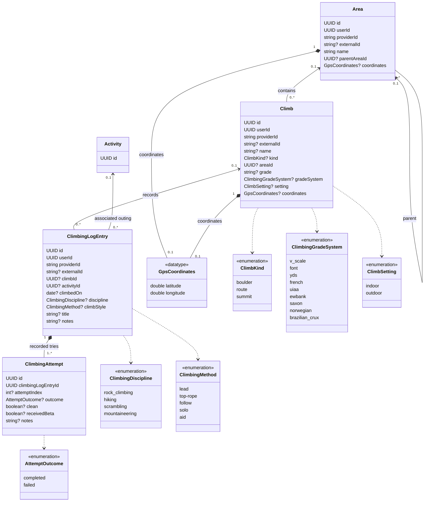

# Shared climbing log model and SummitPost provider

Status: domain model approved in conversation on 2026-10-13. This written
specification consolidates that model, its migration, and SummitPost ingestion.
Coordinate storage uses PostgreSQL's native point type as requested.
Implementation follows review of this specification and its written plan.

## Intended outcome

Import all of the connecting user's SummitPost logs, including hikes,
scrambles, mountaineering, rock climbs, and unsuccessful outings. Use the same
canonical model as existing climbing ticks, with appropriate server queries
and UI filters on web and mobile.

The agreed vocabulary is:

- **Area**: a named containing place, optionally inside another Area.
- **Climb**: the named mountain, route, or boulder, distinct from its containing
  places.
- **ClimbingLogEntry**: one source-recorded account of undertaking a Climb.
  Preserve whether it describes one try or summarizes several.
- **ClimbingAttempt**: one individually recorded try belonging to a log entry.
- **Activity**: an optional timed outing associated with the log entry.

A successful ascent is an outcome; it does not require a second entry model.
Provider vocabulary alone does not establish success. OpenBeta's
[Tick schema](https://github.com/OpenBeta/openbeta-graphql/blob/develop/src/graphql/schema/Tick.gql)
includes attempts, theCrag's
[tick types](https://www.thecrag.com/en/article/ticktypes) include Attempt,
Working, and Retreat, and KAYA exposes
[attempts and sends](https://kayaclimb.com/support-articles/logging-your-climbs-on-kaya).

## Canonical entities and names

Use these names consistently in application types, ORM exports, API contracts,
database relations, tests, and active documentation.

| Entity | ORM export | Database relation |
| --- | --- | --- |
| `Area` | `area` | `fitness.area` |
| `Climb` | `climb` | `fitness.climb` |
| `ClimbingLogEntry` | `climbingLogEntry` | `fitness.climbing_log_entry` |
| `ClimbingAttempt` | `climbingAttempt` | `fitness.climbing_attempt` |
| Canonical serving projection | Corresponding log-entry query types | `fitness.v_climbing_log_entry` |

Foreign keys use `parentAreaId`, `areaId`, `climbId`, `climbingLogEntryId`,
and `activityId`, with snake_case database names.

The diagram shows principal fields; retained context and lifecycle fields are
specified below. A question mark denotes a nullable field.

Use the same enum definitions in shared application schemas and PostgreSQL,
rather than accepting arbitrary strings. Missing or unrecognized values stay
null, and unfamiliar source labels remain in provenance. `completed` means
the recorded objective was achieved; `failed` means explicitly unsuccessful.
Clean climbing is a separate nullable fact on the attempt, not another
completion status. `sent` becomes a server-derived label for completed clean
rock attempts, without a stored send flag or enum member.
The approved `climbStyle` field uses the climbing-method enum.
Retain the existing [grade-system values](../../../src/db/schema/enums.ts)
when moving the enum-backed field to Climb. Grade itself remains text; its
validation uses the selected recognized system.

### Area and Climb

Area and Climb rows are user-owned and provider-scoped. They describe source
objects; this change does not reconcile different providers into a global
catalogue. UUIDs are local identities. Nullable `externalId` values identify
verified source objects within their provider's object namespace; include that
namespace when different source object types can reuse an ID.

Area has a nonempty `name` and nullable `parentAreaId`.
The parent is the nearest recorded containing Area: omitted intermediate
levels must not be invented. A null parent means no parent is recorded.
Climb has a nullable nonempty `name`, nullable recorded `kind`
(boulder, route, or summit), nullable `areaId`, nullable `grade` and
`gradeSystem`, and nullable source-evidenced indoor/outdoor `setting`.
Its name stays separate from the area chain, matching the existing
[climbing-context contract](../../climbing-context.md).
Destination/area/subarea labels remain source provenance; the parent
relationship represents their hierarchy. An explicitly recorded gym supplies
indoor setting evidence without introducing an Area taxonomy.

Use self-referential and owner/provider-scoped foreign keys, index parent and
area references, and reject cycles, including concurrent parent updates.
A foreign key guarantees a referenced row exists; it does not make a hierarchy
acyclic. PostgreSQL documents
[self-referential foreign keys](https://www.postgresql.org/docs/current/ddl-constraints.html#DDL-CONSTRAINTS-FK)
and [recursive traversal with cycle detection](https://www.postgresql.org/docs/current/queries-with.html#QUERIES-WITH-RECURSIVE).
Build the ordered `areaPath` and display name on the server through recursive
queries. Store no parallel JSON breadcrumb, materialized path, closure table,
or ltree representation.

Shared source objects are updated from verified current provider metadata.
A rename or hierarchy change updates what all associated historical entries
display, as requested. An incomplete response must not erase known names or
parentage; verified removal is different from an omitted field.

### Coordinates

Area and Climb each have one nullable `coordinates` field of value type
`GpsCoordinates { latitude, longitude }`. This is a value owned by its entity,
without a separate row identity or coordinates table. Both members are required
when the value exists. Use one shared schema/type at ingestion and API
boundaries; do not create provider-specific coordinate value types.

Persist the value as one nullable `coordinates` column of PostgreSQL's native
[point type](https://www.postgresql.org/docs/current/datatype-geometric.html#DATATYPE-GEOMETRIC-POINTS)
in each owning table. Use `x = longitude` and `y = latitude`, consistently at
every persistence boundary. Drizzle's built-in
[point mapping](https://orm.drizzle.team/docs/column-types#point) supports an
`{ x, y }` representation; translate that to the shared `GpsCoordinates`
value on the server. Do not implement a parallel custom PostgreSQL type.
Validate finite decimal-degree values with latitude in -90..90 and longitude
in -180..180. Missing pairs stay null; zero is valid. Do not guess coordinates
from names or replace missing points with zero.
The native point is the one database representation. Do not retain separate
latitude/longitude columns, a JSON copy, or a coordinate-entity foreign key.
Its plane coordinates represent decimal degrees by this application contract;
native planar distances are not geographic distances in meters. PostgreSQL
documents its [geometric operations](https://www.postgresql.org/docs/current/functions-geometry.html).

Store each point on the object the provider locates. OpenBeta's official
[Climb schema](https://github.com/OpenBeta/openbeta-graphql/blob/develop/src/graphql/schema/Climb.gql)
offers climb latitude/longitude; its
[Area schema](https://github.com/OpenBeta/openbeta-graphql/blob/develop/src/graphql/schema/Area.gql)
labels area points as bounding-box centers. Keep those on Area rather than
copying them onto Climb. SummitPost displays object points on observed
[mountain](https://www.summitpost.org/mountain/150189) and
[route](https://www.summitpost.org/west-ridge/155696) pages.
The current [KAYA client](../../../packages/kaya-client/src/client.ts) requests
gym and session-location coordinates; verified containing-location points
belong on Area. Mountain Project's
[previous endpoint audit](../../mountain-project.md#location-angle-and-board-coverage)
found route/area points, but the current CSV import does not supply them.

Extend provider selections and normalization where verified source contracts
permit, backfill verified points from retained raw data, and keep unavailable
points null. Verify SummitPost extraction with permitted HTML fixtures.
Expose these canonical fields through shared APIs, web/mobile record details,
and account exports. Updating a shared point updates historical displays just
like its shared name. Do not store a second point on a log entry or add spatial
indexing/dependencies without a concrete spatial-query requirement.

### ClimbingLogEntry and ClimbingAttempt

Evolve the existing [climbing-entry table](../../../src/db/schema/activity.ts)
in place into `climbing_log_entry`, preserving row IDs, provider occurrence
identities, raw payloads, tombstones, and existing attempts.

| Log-entry field | Meaning and constraint |
| --- | --- |
| `userId`, `providerId` | Required owner and recorded source. |
| `externalId` | Source occurrence identity; distinct from a Climb's identity. Preserve existing provider-specific uniqueness scopes. |
| `climbId` | Reference to the recorded Climb; nullable only when no identifying climb facts are supplied. |
| `activityId` | Nullable association to a same-user Activity. |
| `climbedOn` | Nullable exact source calendar date, independent of activity attachment. |
| `discipline` | Nullable source-evidenced rock-climbing, hiking, scrambling, or mountaineering classification. |
| `title`, `notes` | Nullable nonempty source text. |
| Existing experience context | Method, protection, board, reported wall angle, and hold type, retaining their recorded meaning. |
| Existing lifecycle metadata | Source name, opaque raw provenance, creation time, and provider-absence tombstone. |

Location belongs to the Climb through `Climb.areaId`. KAYA's
[current adapter](../../../src/providers/kaya-sync.ts) can obtain a missing
gym from the associated ascent or session. Use verified session context to
complete a missing Climb location; separate source fields do not establish a
second canonical location relationship. If supplied locations conflict,
resolve them from verified current metadata before updating shared containment.

Store the climb's grade and grading system only on Climb. Updating a shared
grade changes what its historical entries display and what grade analytics
use. Remove the old log-level grade columns; keep original source values in
opaque provenance. A separately recorded personal grade opinion is a distinct
fact and must not be relabeled as the climb's published grade. This change
does not add a second normalized generic-grade path. Retain other existing
experience context without guessing whether ambiguous historical values
were object or event properties.

Rename the attempt foreign key to `climbing_log_entry_id`; preserve existing
attempt IDs, recorded facts, and notes. Outcome becomes nullable so
source-count-only attempts do not require invented details. Remove the old
failure-reason field, enum, and requirement that a failed attempt have a
structured reason. Provider notes remain source text rather than being parsed
into an unsupported cause taxonomy.

A source-reported count of N actual tries creates N partially described
attempt rows. Unknown outcomes, clean-climbing conditions, beta, order,
notes, and times remain unknown.
A source-logged occurrence with no total supplied creates one recorded
attempt. This represents the recorded occurrence and asserts nothing about
unreported tries. Preserve any explicitly described individual attempts.
Reuse rows on resync and reconcile reported counts with already described
attempts; do not
append the count to an existing collection and count the same tries twice.

The server derives recorded attempt counts from the stored rows. Do not store
or infer whether the source history is complete or incomplete. Counts describe
recorded attempts, not a claimed lifetime total. Nullable `attemptIndex`
describes actual attempt order across the same user's verified Climb, when
established by the source. A provider first-try designation sets it to 1 and
places that attempt first in the Climb's history. Do not assign actual indices
just by sorting imported records or creating count-based rows. Unknown actual
positions remain null. Creation timestamps remain ingestion metadata.
Legacy per-log indices do not by themselves establish actual global indices;
resolve their meaning from source evidence before converting existing rows.

Attempt.outcome is the canonical recorded result. Retain a source-described
successful or unsuccessful try without assuming anything about unreported
tries. `clean` records whether the climbing was free of falls, rests on the
rope, and aid, independently of achieving its goal. Set it only from verified
source evidence; goal completion alone establishes no clean-climbing fact.
Store no separate log success boolean or result label. Original qualifiers
remain in opaque provenance; labels are derived
only when normalized recorded facts establish them.

`ClimbingAttempt.receivedBeta` is nullable recorded knowledge before the try.
For a source entry explicitly marked Flash with no prior retained attempts or
ascents on the same verified Climb, record `receivedBeta = true` on its
successful attempt. The explicit qualifier supplies this evidence; absence
of earlier records alone supplies none. Keep absent beta knowledge null.
Exclude the current log and its own attempts from the prior-history check,
so resyncing the same Flash remains idempotent.
Source-reported qualifiers remain available in opaque provenance. Derive
onsight/flash labels only when success and actual first-try history are also
established. Explicit Onsight/Flash supplies first-try order evidence;
normalize that to `attemptIndex = 1`, without storing a firstTry boolean.

| Source evidence | outcome | clean | receivedBeta | attemptIndex |
| --- | --- | --- | --- | --- |
| Explicit Onsight | completed | true | false | 1 |
| Explicit Flash with no prior retained attempts/ascents | completed | true | true | 1 |
| Explicit clean Send | completed | true | null | null unless supplied |
| Fell/Hung without completion information | null | false | null | null unless supplied |
| Summit reached | completed | null | null | null unless supplied |
| Turned back before summit | failed | null | null | null unless supplied |

The Flash mapping uses the stated history condition, excluding the current
log and its own attempts. If that condition is not met, retain the qualifier
in provenance and do not guess beta knowledge without independent evidence.
Provider-established first-try order remains source evidence.
The explicit labels' first-try/beta meanings are documented in OpenBeta's
[tick schema](https://github.com/OpenBeta/openbeta-graphql/blob/develop/src/graphql/schema/Tick.gql).
Provider-specific mappings require verified semantics. A rock send is derived
from completed outcome and known clean climbing; Onsight/Flash additionally
require actual index 1 and known beta facts. Unknown facts do not receive a
classification simply because no earlier imported history exists.

## Source identity and hierarchy migration

Reuse Area and Climb rows through verified source object IDs within their
owner/provider scope. Names and matching breadcrumbs alone do not prove
identity. A named source object without a verified external ID receives a
local UUID. Repeated syncs reuse its existing association through the stable
source log identity; they do not guess cross-log identity from names.

For legacy data:

1. Inventory existing IDs, source keys, names, location paths, dates, grades,
   associations, tombstones, and attempt IDs before conversion.
2. Separate source Climb IDs from log occurrence IDs using verified raw fields.
   Examples are a Mountain Project route ID versus tick identity, OpenBeta
   climb UUID versus tick ID, and KAYA climb ID versus ascent/session record.
3. Walk existing paths broadest to nearest to create Area chains. Reuse nodes
   with verified source IDs. Nodes without IDs remain local to their verified
   Climb or source occurrence; unrelated matching names do not merge.
4. Set Climb containment from its recorded path, including verified associated
   session context when the source object lacks its own location. Resolve
   inconsistent paths before merging verified Climb identities. Convert
   existing verified setting evidence into Climb.setting, leaving unknown
   setting null; provider hierarchy-role labels remain raw provenance.
5. Reuse missing-ID chains for repeated observations of the same verified
   Climb when their recorded chains agree. A changed chain can replace that
   Climb's association; remove superseded unreferenced imported objects as
   part of the conversion/update transaction.
6. Move the source-reported Climb grade/system to Climb and remove duplicate
   normalized log storage. Resolve differing grades for the same verified
   Climb using current authoritative source metadata, preserving old supplied
   values only in opaque provenance.
7. Resolve conflicting definitions of a verified source object from an
   authoritative source update timestamp or verified current source metadata.
   Row creation time is not such a timestamp. If neither is available, fail
   preflight before destructive conversion and report the specific conflict.
8. Convert attempts using their recorded semantics: an existing explicit clean
   send establishes completed outcome and clean climbing; explicit Fell/Hung
   establishes unclean climbing without necessarily establishing failure to
   reach the top. A generic legacy unsuccessful-send value alone must not
   establish either objective noncompletion or specific climbing conditions.
   Recover objective-completion and actual-order facts only when source evidence
   supplies them. Inventory any legacy row whose known facts cannot be represented
   before removing the old columns.

After conversion, current provider metadata is the shared definition.
There is no normalized historical-location snapshot or version infrastructure.
Opaque upstream payloads remain provenance and are not a second application
storage path. Cross-provider observation selection remains query-time;
separate provider objects must not automatically produce duplicate sends.

## Date, difficulty, and outcome semantics

Missing date, difficulty, discipline, and result remain independently unknown
and never prevent browsing. Represent a source-logged occurrence as one
recorded attempt unless supplied count or individual-try records establish
more. Do not assume success, fabricate dates, or extract grades from narrative
notes.
Climb.grade is nullable recorded difficulty text. A recognized grade system
requires a nonempty valid grade. An unknown system may retain recorded text
with a null normalized system; preserve unfamiliar source system labels in
raw provenance.

`climbedOn` survives attachment. Remove the existing activity/date constraint.
Previously erased source dates remain unknown unless recovered from a verified
raw source date; the associated activity's date is not a replacement.
Use the existing [date-string contract](../../../packages/server/src/lib/typed-sql.ts)
to serve `YYYY-MM-DD` without timezone conversion.

The server derives log outcomes from recorded attempt results. These describe
the logged experience and make no claims about unreported tries. Never store
a duplicate inferred log success. Normalize explicitly supplied source outcomes
and recognized qualifiers into the corresponding attempt facts. Keep the
clean-send projection for rock analytics separate: source summit completion
alone cannot establish a clean rock send, even when a technical grade is
present. Preserve the distinctions documented in
[climbing context](../../climbing-context.md#interpretation).

A mountain, a route, a possible activity listed on an object page, or a missing
grade does not establish the entry's discipline. Existing records migrate
with their established rock-climbing semantics; newly ambiguous records stay
unclassified. Method (lead, top-rope, follow, solo, aid) remains separate from
discipline and Climb kind.

Both physical and soft deletion of an Activity clear associations while
preserving source logs and dates. Physical deletion uses a same-user foreign
key with column-specific
[SET NULL](https://www.postgresql.org/docs/current/ddl-constraints.html#DDL-CONSTRAINTS-FK);
the [activity repository](../../../packages/server/src/repositories/activity-repository.ts)
must unlink logs in the same transaction as its soft deletion.
Deleting a log deletes its owned attempts.

## SummitPost access and synchronization

The target profile is
[asherlc-asherlc-com / 182146](https://www.summitpost.org/users/asherlc-asherlc-com/182146).

SummitPost's [FAQ](https://www.summitpost.org/faq.html) describes climber logs.
An observed [example profile](https://www.summitpost.org/users/scott/16365)
exposes signed-log links to
[individual entries](https://www.summitpost.org/cervidae-peak/climbers-log/155243/d-209680).
Observed pages distinguish posting date from optional climbed date and include
authors, titles, notes, result markers, and replies.

Research on 2026-10-13 did not locate a documented API or native export;
this does not prove neither exists. The supplied profile was unavailable to
the web reader and the browser runtime had no connected browser, so its
contents and count are unverified. Before parser implementation, obtain
representative profile/list/log HTML through permitted ordinary access or
owner-supplied saved pages. Verify pagination, author isolation, object/log
identity, and entry-versus-reply boundaries. Search excerpts are not parser
fixtures; do not guess selectors. Respect the source's
[access instructions](https://www.summitpost.org/robots.txt) and
[author rights](https://www.summitpost.org/tos.html).

Reuse the shared public-profile connection flow. Accept and validate a fixed
SummitPost-origin URL with numeric user identity, storing resolved identity
per user through the token repository. Explicitly classify public-profile
identity as having no remote authorization to revoke, including existing
public-profile providers; update
[erasure snapshotting](../../../src/account-erasure/remote-snapshot.ts)
rather than inventing a successful revocation hook.

Discover all signed-log pages, traverse verified pagination, and import only
the connected author's entries in every category. Retain repeated logs on one
Climb as separate occurrences. Use verified object/log ID pairs for idempotent
upserts. Do not apply climb-date filtering to full-list traversal or treat a
missing/partial list as deletion evidence.

Keep the adapter isolated under `src/providers/`, using shared provider HTTP,
queue, runtime-validation, telemetry, and actionable sync-error contracts.
Use an established HTML parser; [Cheerio](https://github.com/cheeriojs/cheerio)
is the proposed maintained MIT option. Check its latest stable release and
security at implementation time. No deployment-wide profile env var is needed.
Register metadata, settings, worker/server entries, exports, and queue policy.

## Serving, web, and mobile

Use **Data Sources → Provider → Records → Climbing log** on both platforms.
The generic query includes every retained log, including ungraded, undated,
and unclassified records. Rows show Climb name, recorded day, and recorded
outcome; absent values remain explicit. Order dated rows newest first, then
undated rows with stable identity tie-breakers. Put notes, source links, and
provenance in details, using text rendering and accessible link names.

Both clients use server-curated columns, retain cached rows during refetch,
and display actionable server errors. Merge indexed user/provider-scoped
Postgres log counts into shared provider statistics, including providers with
no sensor data. Add `climbingLogEntries` to shared record/count contracts.

Filters distinguish Climb kind, discipline, method, protection, and setting.
Derive paths on the server from current Area relationships and filter setting
through Climb.setting, preserving existing verified setting evidence without
using provider identity or place names as proof. Clients render values; they
do not calculate metrics. Keep unclassified records accessible.
This intentionally replaces the current Mountain Project/OpenBeta
provider-wide outdoor assumption with source-evidenced setting. Previously
inferred outdoor classifications become unknown unless independently verified.

Rock queries apply eligibility before grade schemas/conversion in both
attached and standalone branches, performance comparison, and training
exposure. Generic summit success never enters clean-send metrics. Preserve
historical rock observations and repeat-occurrence matching. Ungraded known
rock observations may contribute to participation; undated records do not
acquire dates for trends. Update activity-type gates and attachment validation
so legitimate hiking/mountaineering associations remain visible.

## Complete cutover and cleanup

The user explicitly requires no obsolete naming or storage paths. Update all
providers, CSV imports, persistence, joins, attachment logic, contracts, MCP
outputs, shared formatting/filter types, web/mobile components, fixtures, and
active documentation in the same change.

- Replace `climbingEntry` / `climbing_entry` and the old view with the canonical
  log-entry names; keep no compatibility aliases or dual writers/readers.
- Move `routeName` / `route_name` and `climbType` / `climb_type` to Climb's
  `name` and `kind`; remove the superseded log columns.
- Move `grade` and `gradeSystem` / `grade_system` to Climb and remove
  normalized log copies. Join Climb for current-grade displays and analytics.
- Replace stored `locationPath` / `location_path` with Area references.
  Serve derived `areaPath` using the current hierarchy.
- Remove the normalized location-node kind contract. Preserve source labels
  only in provenance and explicit setting evidence on Climb.
- Replace `unattachedDate` / `unattached_date` with `climbedOn` /
  `climbed_on`; attachment must not determine source-date storage.
- Remove ambiguous general-purpose send/ascent aliases. Preserve legitimate
  rock-specific sends and exact vendor vocabulary inside upstream contracts.
- Remove log-level `attemptCount`, `reportedSuccess`, and `resultStyle` storage
  after normalizing the supplied facts into attempts. Derive counts/outcomes
  on the server from recorded attempts, without completeness metadata.
- Rename attempt foreign keys, constraints, indexes, public symbols, and
  source filenames whose names represent the superseded model.
- Drop `climbing_attempt.failure_reason`, its enum and reason constraints,
  and remove corresponding fields/types from active contracts, readers,
  writers, exports, clients, and documentation. Keep no runtime alias.
- Update provider record/deletion inventories, account export CSVs, erasure
  write fences, generated DBML/UML, active guides, and executable maintenance
  tooling. Retire obsolete backfill commands rather than leaving broken tools.

Area and Climb ownership makes provider deletion and account erasure complete:
remove attempts/logs, climbs, and areas without deleting another provider's
associated activities. Include all canonical entities in
[account export](../../../src/export.ts) and follow the existing
[deletion](../../provider-data-deletion-runbook.md) and
[erasure](../../account-erasure-runbook.md) inventories.

Preserve already deployed numbered migrations, journal identities, and dated
historical evidence; use forward migrations. Historical upgrade fixtures and
opaque source payloads may retain original names because they describe actual
history. They are not active compatibility paths.

This is a coordinated schema/application cutover. Inventory and quiesce old
readers/writers, convert and validate, remove old storage, then resume only
the matching application version. Do not rely on rolling deployment to bridge
breaking names. Follow the
[maintenance-cutover procedure](../../climbing-context.md#maintenance-cutover)
and [schema migration policy](../../schema.md): large data conversion belongs
in bounded resumable operational tooling outside schema-only deployment
migrations. No production cutover or external-provider refresh is performed
merely by approving this design.

## Validation and acceptance

Start with failing executable PostgreSQL tests for entity reuse, missing IDs,
hierarchy rename/reparenting on historical logs, cycle rejection, namespace
and ownership isolation, shared-grade updates, coordinate pair/range checks,
coordinate ownership, Flash-to-beta/order normalization, independent clean
and completion facts, and partial-source updates.
Exercise migration preservation, current-metadata conflict resolution,
nullable grades/dates,
source occurrence idempotency, count-to-row conversion, missing-count logged
occurrences, outcome derivation, and both forms of activity deletion.
Test log browsing, counts, export, provider deletion, and erasure
against the canonical schema.

Cover grade analytics, setting filters, repeat-observation selection, and
training exposure with real database fixtures. Cover both web and mobile
connection/records/detail/attachment interactions. Provider parser tests use
verified HTML; network-level integration fixtures cover pagination, ownership,
replies, repeats, missing fields, malformed responses, and actionable errors.

Run full lint, all package typechecks, focused unit/mobile tests, and required
database integrations before implementation pushes. Do not add static tests
whose only purpose is proving old names disappeared; review the cleanup diff
and compile every consumer.

Completion requires one canonical entity model everywhere, no obsolete active
storage/contracts, preserved source identities and outcomes, the approved
shared-grade/location behavior and setting changes, stored source coordinates,
and import of all verified SummitPost signed-log categories. Fixture-only
verification does not establish a successful sync of the supplied profile.
