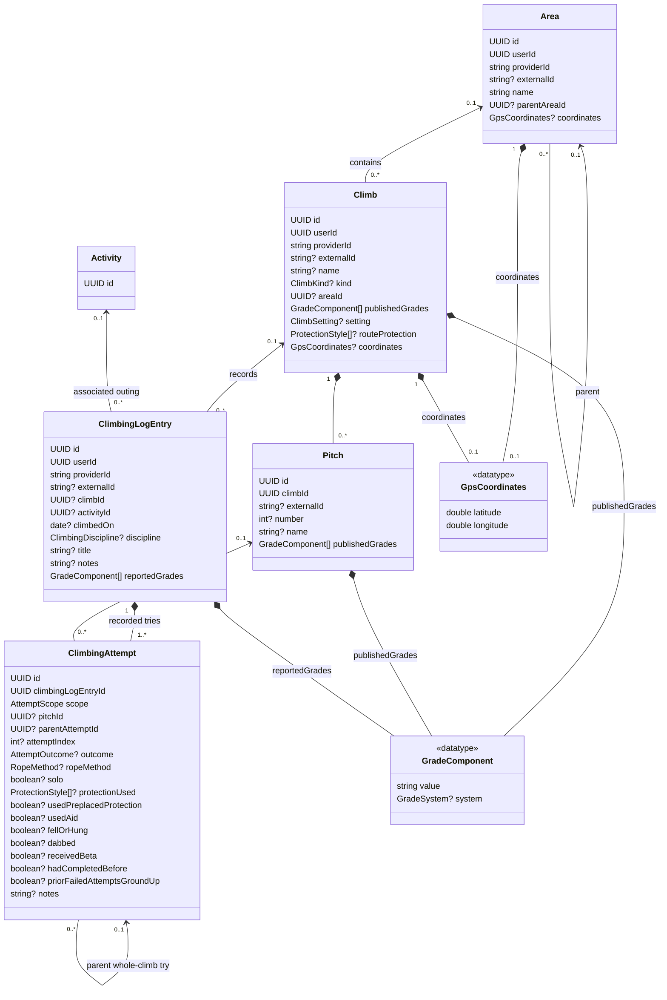
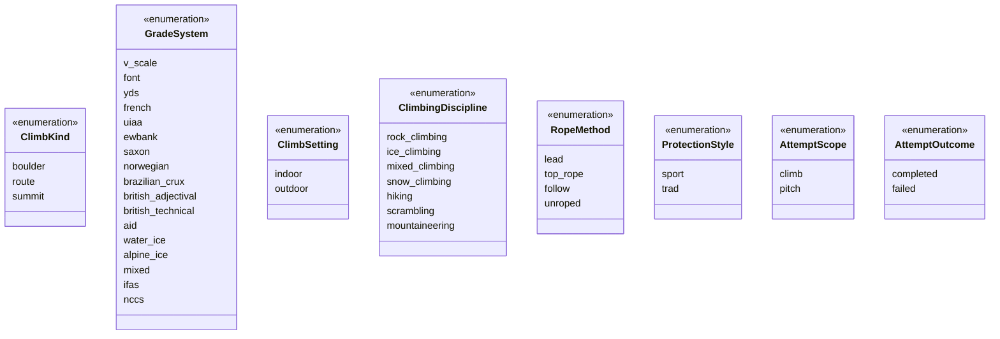

# Shared climbing log model and SummitPost provider

<!-- cspell:words AICE AIDC belayer DBML Greenpoint IFAS ltree NCCS NCCST preplaced reparenting unroped WICE -->

Status: initial domain model approved on 2026-10-13; revised UML and the
nullable `fellOrHung` simplification approved in conversation on 2026-10-14.
The revised written specification was approved on 2026-10-14. This revision
consolidates the approved discussion, its migration, and SummitPost ingestion.
The aligned implementation plan was approved and Native execution resumed.
Coordinate storage uses PostgreSQL's native point type as requested.

## Intended outcome

Import all of the connecting user's SummitPost logs, including hikes,
scrambles, mountaineering, rock climbs, and unsuccessful outings. Use the same
canonical model as existing climbing ticks, with appropriate server queries
and UI filters on web and mobile.

The agreed vocabulary is:

- **Area**: a named containing place, optionally inside another Area.
- **Climb**: the named mountain, route, or boulder, distinct from its containing
  places.
- **Pitch**: an individually identified section of a route, belonging to a Climb.
- **ClimbingLogEntry**: one source-recorded account of undertaking a Climb.
  Preserve whether it describes one try or summarizes several.
- **ClimbingAttempt**: one recorded try at the whole Climb or at a pitch,
  belonging to a log entry. The same model holds either scope.
- **GradeComponent**: a recorded difficulty value and its nullable grading system.
- **Activity**: an optional timed outing associated with the log entry.

A successful ascent is an outcome; it does not require a second entry model.
Provider vocabulary alone does not establish success. OpenBeta's
[Tick schema](https://github.com/OpenBeta/openbeta-graphql/blob/develop/src/graphql/schema/Tick.gql)
includes attempts, theCrag's
[tick types](https://www.thecrag.com/en/article/ticktypes) include Attempt,
Working, and Retreat, and KAYA exposes
[attempts and sends](https://kayaclimb.com/support-articles/logging-your-climbs-on-kaya).

## Canonical entities and names

Use these names consistently in application types, ORM exports, API contracts,
database relations, tests, and active documentation.

| Entity | ORM export | Database relation |
| --- | --- | --- |
| `Area` | `area` | `fitness.area` |
| `Climb` | `climb` | `fitness.climb` |
| `Pitch` | `pitch` | `fitness.pitch` |
| Published Climb grade component | `climbGrade` | `fitness.climb_grade` |
| Published Pitch grade component | `pitchGrade` | `fitness.pitch_grade` |
| Separately reported log grade component | `climbingLogEntryGrade` | `fitness.climbing_log_entry_grade` |
| `ClimbingLogEntry` | `climbingLogEntry` | `fitness.climbing_log_entry` |
| `ClimbingAttempt` | `climbingAttempt` | `fitness.climbing_attempt` |
| Canonical serving projection | Corresponding log-entry query types | `fitness.v_climbing_log_entry` |

Foreign keys use `parentAreaId`, `areaId`, `climbId`, `pitchId`,
`climbingLogEntryId`, `parentAttemptId`, and `activityId`, with snake_case
database names. Grade rows have exactly one owning entity through their table's
required foreign key. `GradeComponent` is the shared value type, not a shared
grade catalogue. Its fields are `value` and `system` consistently in storage
and application contracts.

The diagram shows principal fields; retained context and lifecycle fields are
specified below. A question mark denotes a nullable field.

Use the same enum definitions in shared application schemas and PostgreSQL.
Missing or unrecognized classifications stay null, and unfamiliar source labels
remain in provenance. `scope` is required: it identifies whether the try
describes the whole Climb or a pitch, including a pitch whose identity is unknown.
`completed` means the recorded goal at that scope was achieved; `failed` means
explicitly unsuccessful at that scope. Completion and execution facts are
independent. Send, Onsight, Flash, and Pinkpoint are server-derived labels;
there is no stored `clean`, `sent`, or `resultStyle` field.

Use `GradeSystem` consistently for the shared type and grade-row `system`
field. Retain the existing grading values and add the verified British,
aid, ice, mixed, and alpine systems below. A component's `value` remains text;
recognized systems validate their own values. No converted grade is stored.

### Area and Climb

Area and Climb rows are user-owned and provider-scoped. They describe source
objects; this change does not reconcile different providers into a global
catalogue. UUIDs are local identities. Nullable `externalId` values identify
verified source objects within their provider's object namespace; include that
namespace when different source object types can reuse an ID.

Area has a nonempty `name` and nullable `parentAreaId`.
The parent is the nearest recorded containing Area: omitted intermediate
levels must not be invented. A null parent means no parent is recorded.
Climb has a nullable nonempty `name`, nullable recorded `kind`
(boulder, route, or summit), nullable `areaId`, an owned collection of
published grade components, and nullable source-evidenced indoor/outdoor `setting`.
Its name stays separate from the area chain, matching the existing
[climbing-context contract](../../climbing-context.md).
Destination/area/subarea labels remain source provenance; the parent
relationship represents their hierarchy. An explicitly recorded gym supplies
indoor setting evidence without introducing an Area taxonomy.

Use self-referential and owner/provider-scoped foreign keys, index parent and
area references, and reject cycles, including concurrent parent updates.
A foreign key guarantees a referenced row exists; it does not make a hierarchy
acyclic. PostgreSQL documents
[self-referential foreign keys](https://www.postgresql.org/docs/current/ddl-constraints.html#DDL-CONSTRAINTS-FK)
and [recursive traversal with cycle detection](https://www.postgresql.org/docs/current/queries-with.html#QUERIES-WITH-RECURSIVE).
Build the ordered `areaPath` and display name on the server through recursive
queries. Store no parallel JSON breadcrumb, materialized path, closure table,
or ltree representation.

Shared source objects are updated from verified current provider metadata.
A rename or hierarchy change updates what all associated historical entries
display, as requested. An incomplete response must not erase known names or
parentage; verified removal is different from an omitted field.

### Pitches and grade collections

Pitch has a required `climbId`, nullable verified source `externalId`, nullable
positive source pitch `number`, nullable nonempty `name`, and its own published
grade components. Its owner and provider follow its containing Climb. A source
pitch ID or verified number within an identified route can establish identity;
matching names alone cannot. OpenBeta's official
[Climb and Pitch schema](https://github.com/OpenBeta/openbeta-graphql/blob/f1508b2479cc7658ac4341d59ec817836190d6d8/src/graphql/schema/Climb.gql)
supplies pitch identity, number, and grades. Its
[tick contract](https://github.com/OpenBeta/openbeta-graphql/blob/f1508b2479cc7658ac4341d59ec817836190d6d8/documentation/tick_logic.md)
does not support pitch ticks; catalogue pitches alone create no pitch attempts.

Each published or reported grade is a `GradeComponent { value, system }`.
Use owned child rows for Climb, Pitch, and log grade collections. Preserve
separately supplied components and equivalent source grading systems. A Climb
can therefore have both `5.12a` in `yds` and `A3` in `aid`, or British
adjectival and technical grades. Do not derive a stored route grade from its
pitch grades or insert converted equivalents. The source documents
[multiple published and separately recorded ascent grades](https://www.thecrag.com/en/article/gradesonthecrag/grade-comparison).

Map grading systems only with verified source meaning: theCrag `AID`/`AIDC`
map to `aid` while retaining their A/C text, `WICE` to `water_ice`, `AICE` to
`alpine_ice`, `MIXED` to `mixed`, `IFAS` to `ifas`, `NCCS` to `nccs`, `UK` to
`british_adjectival`, and `UKT` to `british_technical`.
`NCCST` is a distinct technical scale; it is not `nccs`. Australian aid and
mixed grades can both use M-prefixed values, so prefixes alone do not establish
their system. Unrecognized systems retain text with null `system`. See the
official [system labels and examples](https://www.thecrag.com/en/article/gradesonthecrag).

`publishedGrades` contains recorded current catalogue components. Their updates
affect historical shared-object displays. `reportedGrades` contains grades
separately supplied for the source log, including an explicit personal opinion
when its meaning is established. Do not copy published grades into this
collection, overwrite it on a catalogue update, or assume every ascent-grade
field is a personal assessment. OpenBeta's
[Tick grade](https://github.com/OpenBeta/openbeta-graphql/blob/f1508b2479cc7658ac4341d59ec817836190d6d8/src/graphql/schema/Tick.gql)
can describe an unmatched imported climb; the observed
[KAYA audit](../../kaya.md#confirmed-request-coverage) has not established that
its separate ascent-grade field always equals the published grade or represents
an opinion. Keep unverified field meanings in raw provenance.

An empty collection means no grade components are recorded. An omitted source
collection does not erase known components; a verified replacement updates
the whole supplied collection, including an explicitly empty one. Preserve
source component order as structural row order when it is supplied. Do not
select a primary component by discarding the others during ingestion.

### Coordinates

Area and Climb each have one nullable `coordinates` field of value type
`GpsCoordinates { latitude, longitude }`. This is a value owned by its entity,
without a separate row identity or coordinates table. Both members are required
when the value exists. Use one shared schema/type at ingestion and API
boundaries; do not create provider-specific coordinate value types.

Persist the value as one nullable `coordinates` column of PostgreSQL's native
[point type](https://www.postgresql.org/docs/current/datatype-geometric.html#DATATYPE-GEOMETRIC-POINTS)
in each owning table. Use `x = longitude` and `y = latitude`, consistently at
every persistence boundary. Drizzle's built-in
[point mapping](https://orm.drizzle.team/docs/column-types#point) supports an
`{ x, y }` representation; translate that to the shared `GpsCoordinates`
value on the server. Do not implement a parallel custom PostgreSQL type.
Validate finite decimal-degree values with latitude in -90..90 and longitude
in -180..180. Missing pairs stay null; zero is valid. Do not guess coordinates
from names or replace missing points with zero.
The native point is the one database representation. Do not retain separate
latitude/longitude columns, a JSON copy, or a coordinate-entity foreign key.
Its plane coordinates represent decimal degrees by this application contract;
native planar distances are not geographic distances in meters. PostgreSQL
documents its [geometric operations](https://www.postgresql.org/docs/current/functions-geometry.html).

Store each point on the object the provider locates. OpenBeta's official
[Climb schema](https://github.com/OpenBeta/openbeta-graphql/blob/develop/src/graphql/schema/Climb.gql)
offers climb latitude/longitude; its
[Area schema](https://github.com/OpenBeta/openbeta-graphql/blob/develop/src/graphql/schema/Area.gql)
labels area points as bounding-box centers. Keep those on Area rather than
copying them onto Climb. SummitPost displays object points on observed
[mountain](https://www.summitpost.org/mountain/150189) and
[route](https://www.summitpost.org/west-ridge/155696) pages.
The current [KAYA client](../../../packages/kaya-client/src/client.ts) requests
gym and session-location coordinates; verified containing-location points
belong on Area. Mountain Project's
[previous endpoint audit](../../mountain-project.md#location-angle-and-board-coverage)
found route/area points, but the current CSV import does not supply them.

Extend provider selections and normalization where verified source contracts
permit, backfill verified points from retained raw data, and keep unavailable
points null. Verify SummitPost extraction with permitted HTML fixtures.
Expose these canonical fields through shared APIs, web/mobile record details,
and account exports. Updating a shared point updates historical displays just
like its shared name. Do not store a second point on a log entry or add spatial
indexing/dependencies without a concrete spatial-query requirement.

### ClimbingLogEntry and ClimbingAttempt

Evolve the existing [climbing-entry table](../../../src/db/schema/activity.ts)
in place into `climbing_log_entry`, preserving row IDs, provider occurrence
identities, raw payloads, tombstones, and existing attempts.

| Log-entry field | Meaning and constraint |
| --- | --- |
| `userId`, `providerId` | Required owner and recorded source. |
| `externalId` | Source occurrence identity; distinct from a Climb's identity. Preserve existing provider-specific uniqueness scopes. |
| `climbId` | Reference to the recorded Climb; nullable only when no identifying climb facts are supplied. |
| `activityId` | Nullable association to a same-user Activity. |
| `climbedOn` | Nullable exact source calendar date, independent of activity attachment. |
| `discipline` | Nullable source-evidenced rock, ice, mixed, snow, hiking, scrambling, or mountaineering classification. |
| `title`, `notes` | Nullable nonempty source text. |
| Existing experience context | Board, reported wall angle, and hold type, retaining their recorded meaning. Method and actual protection use belong to the described attempt. |
| Existing lifecycle metadata | Source name, opaque raw provenance, creation time, and provider-absence tombstone. |

Location belongs to the Climb through `Climb.areaId`. KAYA's
[current adapter](../../../src/providers/kaya-sync.ts) can obtain a missing
gym from the associated ascent or session. Use verified session context to
complete a missing Climb location; separate source fields do not establish a
second canonical location relationship. If supplied locations conflict,
resolve them from verified current metadata before updating shared containment.

Published Climb and Pitch grades live in their owned grade rows; separately
reported log grades live in the log's owned grade rows. Remove scalar grade
and grade-system columns from Climb and log storage. Catalogue updates change
published-grade displays and grade analytics while preserving reported log
grades. Retain original source values and uncertain meanings in provenance.

Climb's nullable `routeProtection` collection records advertised sport/trad
protection when supplied. Attempt's nullable `protectionUsed` collection records
actual protection used. Do not populate actual use from catalogue style alone.
This distinction permits source-evidenced Greenpoint: trad protection used on
a sport route. Source labels and semantics are documented by
[theCrag](https://www.thecrag.com/en/article/ticktypes).
Retain board, wall-angle, and hold-type context at its established source scope
without guessing whether ambiguous historical values were object or event properties.

Rename the attempt foreign key to `climbing_log_entry_id`; preserve existing
attempt IDs, recorded facts, and notes. Outcome becomes nullable so
source-count-only attempts do not require invented details. Remove the old
failure-reason field, enum, and requirement that a failed attempt have a
structured reason. Provider notes remain source text rather than being parsed
into an unsupported cause taxonomy.

### Attempt scope, counts, and order

Every attempt has `scope = climb` or `scope = pitch`. A whole-Climb attempt
has no `pitchId` or `parentAttemptId`. A pitch attempt may reference an
identified Pitch belonging to the log's Climb. Its nullable `parentAttemptId`
may reference a whole-Climb attempt in the same log only when the source
establishes that grouping. Parent links are one level deep; pitch attempts
cannot own further child attempts. An unidentified pitch try can retain
`scope = pitch` with null `pitchId`, without inventing a Pitch definition.

One source occurrence owns all of its scoped attempts. A pitch-only log creates
pitch attempts and zero whole-Climb attempts. Completing a pitch, including
every retained pitch, does not by itself establish whole-Climb completion.
TheCrag's [personal API](https://www.thecrag.com/en/article/logbookreadapi)
documents pitch-level results; their exact payload shape must be verified
before normalization. A reported number of pitches is not a try count and
does not create synthetic pitch attempts. Preserve unverified extent in provenance.

A source-reported count of N actual tries creates N partially described
attempt rows at the source's reported scope. Unknown outcome, rope method,
solo status, protection use, aid use, falls/hangs, dabs, beta, history, order,
notes, and times remain unknown. A total does not apply one described result
to every row. A source-logged occurrence without a total creates one recorded
attempt at its established scope; an explicit collection of pitch results
does not additionally create a whole-route try. Preserve explicitly described
individual tries and reconcile counts within the same scope and identified
Climb/Pitch, retaining child row IDs. Never append the total to the existing
collection or combine overlapping source summaries without evidence.

The server derives separate whole-Climb and pitch attempt counts. A parent
and its child pitch attempts never count together as a whole-Climb total.
Counts describe recorded tries, not a claimed lifetime total. Store no
attempt-count or history-completeness flag.

Nullable `attemptIndex` describes actual order across the same user's verified
Climb or Pitch. An explicit first-try designation sets it to 1 for that target,
without assigning indices by import order or count expansion. Actual order
for an unidentified pitch remains unknown. Legacy per-log indices do not
establish global target history. Creation timestamps remain ingestion metadata.

### Attempt facts and derived labels

Attempt.outcome is the canonical recorded completion result at its scope.
Retain explicitly successful or unsuccessful tries without assuming unreported
tries or copying pitch outcomes onto a parent. A source marking an attempt as
unsent does not necessarily report failure to complete the climb: OpenBeta
[converts Mountain Project's Fell/Hung label into Attempt](https://github.com/OpenBeta/openbeta-graphql/blob/f1508b2479cc7658ac4341d59ec817836190d6d8/documentation/tick_logic.md).
Keep outcome null when the source's physical completion meaning is ambiguous.

`fellOrHung` is one nullable source fact: true means a reported fall or hang;
false means evidence that neither occurred; null means unknown. Do not create
separate fall/rest booleans, a fall/rest union, or a condition-event table.
Current Mountain Project and theCrag labels combine the two conditions;
theCrag defines Hang dog as resting or falling in its
[tick definitions](https://www.thecrag.com/en/article/ticktypes). KAYA's
[currently selected contract](../../../packages/kaya-client/src/client.ts)
provides ascent labels, counts, and comments, without separate fall/rest events.
Notes remain source text; do not infer structured events from narrative text.

Rope method, solo status, and aid use are independent nullable facts on the
attempt. Lead solo is `ropeMethod = lead, solo = true`; top-rope solo is
`ropeMethod = top_rope, solo = true`. Aid solo establishes `solo = true` and
`usedAid = true`, leaving rope method unknown unless supplied. `solo` means
climbing without a partner belayer, not necessarily physical solitude.
French-free establishes gear assistance and can coexist with lead climbing;
it does not establish falling or hanging. These combinations are documented
by [OpenBeta](https://github.com/OpenBeta/openbeta-graphql/blob/f1508b2479cc7658ac4341d59ec817836190d6d8/documentation/tick_logic.md)
and [theCrag](https://www.thecrag.com/en/article/ticktypes).

Aid alone never sets `fellOrHung`. Normal gear support during aid is not a
reported fall or hang. Aid completion is independent of aid use and resting.
TheCrag's Aid Onsight/Flash wording says no resting but does not explicitly
establish no falls, so it cannot supply `fellOrHung = false`; preserve that
qualifier in raw provenance. In aid, clean describes hammerless protection
ethics, rather than fall-free execution. See Chris McNamara's firsthand
[AAJ account](https://publications.americanalpineclub.org/articles/12199811700/Free-Fast-and-Clean-The-Future-of-Yosemite-Climbing).

`dabbed` records source-described contact with ground or a person in bouldering.
A Dab can describe completion while excluding a valid boulder send; it does
not imply falling. `usedPreplacedProtection` records the distinct Pinkpoint
fact. Both definitions are given by [theCrag](https://www.thecrag.com/en/article/ticktypes).

`hadCompletedBefore` and `priorFailedAttemptsGroundUp` retain explicit source
history claims from Repeat and Ground-up Redpoint respectively. Do not set
false from missing imported history, invent earlier attempts, or assign an
exact index from either claim. Preserve contradictory qualifiers in provenance
and do not force a consistent derived label. The source's
[definitions](https://www.thecrag.com/en/article/ticktypes) establish their scope.

Derive a free rock send only from completion and sufficient source evidence:
`outcome = completed`, `fellOrHung = false`, `usedAid = false`, and, for a
boulder, `dabbed = false`. Unknown relevant conditions supply no send claim.
A completed aid ascent remains completed without being classified as a free
send. Do not store `clean`, `sent`, a duplicate log success, or an inferred
result label. Raw qualifiers remain available independently.

`ClimbingAttempt.receivedBeta` is nullable recorded knowledge before the try.
For a source entry explicitly marked Flash with no prior retained attempts or
ascents on the same verified Climb/Pitch, record `receivedBeta = true` on its
successful attempt. The explicit qualifier supplies this evidence; absence
of earlier records alone supplies none. Keep absent beta knowledge null.
Exclude the current log and its own attempts from the prior-history check,
so resyncing the same Flash remains idempotent.
Source-reported qualifiers remain available in opaque provenance. Derive
onsight/flash labels only when success and actual first-try history are also
established. Explicit Onsight/Flash supplies first-try order evidence;
normalize that to `attemptIndex = 1`, without storing a firstTry boolean.

| Source evidence at the described scope | outcome | fellOrHung | usedAid | receivedBeta | attemptIndex |
| --- | --- | --- | --- | --- | --- |
| Explicit free Onsight | completed | false | false | false | 1 |
| Explicit free Flash with no prior retained target history | completed | false | false | true | 1 |
| Explicit free Send | completed | false | false | null | null unless supplied |
| Fell/Hung without completion information | null | true | null | null | null unless supplied |
| Explicit Dab | completed | null | null | null | null unless supplied |
| Explicit Aid Onsight | completed | null | true | false | 1 |
| Explicit Aid Flash with no prior retained target history | completed | null | true | true | 1 |
| Summit reached | completed | null | null | null | null unless supplied |
| Turned back before summit | failed | null | null | null | null unless supplied |

An explicit free boulder send qualifier also establishes `dabbed = false`;
Dab establishes `dabbed = true`. Pinkpoint additionally establishes preplaced
protection. Apply every mapping only at the scope the source describes;
partial-route reports do not establish whole-route completion.

The Flash mapping uses the stated history condition, excluding the current
log and its own attempts. If that condition is not met, retain the qualifier
in provenance and do not guess beta knowledge without independent evidence.
Provider-established first-try order remains source evidence for the same
identified Climb/Pitch. Resolve the complete incoming batch at that scope
before evaluating history; a whole-route try does not establish the order of
an individual pitch, or vice versa.
The explicit labels' first-try/beta meanings are documented in OpenBeta's
[tick schema](https://github.com/OpenBeta/openbeta-graphql/blob/develop/src/graphql/schema/Tick.gql).
Provider-specific mappings require verified semantics. Free Onsight/Flash
additionally require actual index 1 and known beta facts. Pinkpoint requires
the corresponding free lead completion and explicit preplaced-protection
evidence. Unknown facts do not receive a classification merely because no
earlier imported history exists. Source-defined aid qualifiers remain distinct
from free-send labels.

## Source identity and hierarchy migration

Reuse Area and Climb rows through verified source object IDs within their
owner/provider scope. Names and matching breadcrumbs alone do not prove
identity. A named source object without a verified external ID receives a
local UUID. Repeated syncs reuse its existing association through the stable
source log identity; they do not guess cross-log identity from names.

For legacy data:

1. Inventory existing IDs, source keys, names, location paths, dates, grades,
   associations, tombstones, and attempt IDs before conversion.
2. Separate source Climb IDs from log occurrence IDs using verified raw fields.
   Examples are a Mountain Project route ID versus tick identity, OpenBeta
   climb UUID versus tick ID, and KAYA climb ID versus ascent/session record.
3. Walk existing paths broadest to nearest to create Area chains. Reuse nodes
   with verified source IDs. Nodes without IDs remain local to their verified
   Climb or source occurrence; unrelated matching names do not merge.
4. Set Climb containment from its recorded path, including verified associated
   session context when the source object lacks its own location. Resolve
   inconsistent paths before merging verified Climb identities. Convert
   existing verified setting evidence into Climb.setting, leaving unknown
   setting null; provider hierarchy-role labels remain raw provenance.
5. Reuse missing-ID chains for repeated observations of the same verified
   Climb when their recorded chains agree. A changed chain can replace that
   Climb's association; remove superseded unreferenced imported objects as
   part of the conversion/update transaction.
6. Move verified published grade components into owned Climb/Pitch grade rows.
   Move only separately reported log grades into log grade rows. Resolve
   differing published definitions using current authoritative source metadata;
   preserve old snapshots and unverified grade meanings in opaque provenance.
   Create Pitch definitions and pitch attempts only from their own source evidence.
7. Resolve conflicting definitions of a verified source object from an
   authoritative source update timestamp or verified current source metadata.
   Row creation time is not such a timestamp. If neither is available, fail
   preflight before destructive conversion and report the specific conflict.
8. Convert attempts using recorded semantics and scope. An explicit free send
   establishes completed outcome, `fellOrHung = false`, `usedAid = false`,
   and, for a boulder, `dabbed = false`. Explicit Fell/Hung establishes
   `fellOrHung = true` without necessarily establishing failure to complete.
   Legacy `clean = false` alone does not establish a fall/hang: aid or a dab
   may account for it. A generic unsuccessful-send value does not establish
   failure to complete or a particular condition. Retain scoped source
   evidence and recover method, solo, protection, history, and actual order
   only when their meanings are established. Inventory and resolve any legacy
   row whose known facts cannot be represented before removing old columns;
   fail conversion preflight rather than inventing a cause or silently losing
   a known fact.

After conversion, current provider metadata is the shared definition.
There is no normalized historical-location snapshot or version infrastructure.
Opaque upstream payloads remain provenance and are not a second application
storage path. Cross-provider observation selection remains query-time;
separate provider objects must not automatically produce duplicate sends.

## Date, difficulty, and outcome semantics

Missing date, difficulty, discipline, and result remain independently unknown
and never prevent browsing. Represent the recorded tries at their reported
scope without adding whole-route tries for pitch-only logs. Do not assume
success, fabricate dates, or extract grades from narrative notes.
Every supplied grade component requires nonempty text. A recognized system
requires a valid value; an unfamiliar system retains text with null `system`
and its original system label in provenance. Select compatible free-climbing
components for grade analytics after eligibility checks. Never count one
attempt multiple times because its Climb has multiple components or equivalent
grading systems. Aid, ice, and commitment components are not free rock grades.

`climbedOn` survives attachment. Remove the existing activity/date constraint.
Previously erased source dates remain unknown unless recovered from a verified
raw source date; the associated activity's date is not a replacement.
Use the existing [date-string contract](../../../packages/server/src/lib/typed-sql.ts)
to serve `YYYY-MM-DD` without timezone conversion.

The server derives whole-Climb and pitch outcomes separately. Whole-Climb
completion requires a completed attempt with `scope = climb`; pitch success
cannot establish it. A pitch-only log can display its recorded pitch results
without claiming route completion. Summaries make no claims about unreported
tries or pitches. Store no duplicate inferred log success. Keep free-send
projections for rock analytics separate: source summit completion alone cannot
establish a free rock send, even when a technical grade is present.
Preserve the distinctions documented in
[climbing context](../../climbing-context.md#interpretation).

A mountain, a route, a possible activity listed on an object page, or a missing
grade does not establish the entry's discipline. Existing records migrate
with their established rock-climbing semantics; newly ambiguous records stay
unclassified. Rope method, solo status, and aid use remain separate from
discipline and Climb kind. OpenBeta's potentially overlapping snow/ice/mixed
[catalogue types](https://github.com/OpenBeta/openbeta-graphql/blob/f1508b2479cc7658ac4341d59ec817836190d6d8/src/graphql/schema/Climb.gql)
do not by themselves establish the discipline of an individual log.

Both physical and soft deletion of an Activity clear associations while
preserving source logs and dates. Physical deletion uses a same-user foreign
key with column-specific
[SET NULL](https://www.postgresql.org/docs/current/ddl-constraints.html#DDL-CONSTRAINTS-FK);
the [activity repository](../../../packages/server/src/repositories/activity-repository.ts)
must unlink logs in the same transaction as its soft deletion.
Deleting a log deletes its owned attempts and reported grade rows. Published
Climb/Pitch grades remain owned by their shared objects while those objects
are referenced by another retained log from the same user and provider.

## SummitPost access and synchronization

The target profile is
[asherlc-asherlc-com / 182146](https://www.summitpost.org/users/asherlc-asherlc-com/182146).

SummitPost's [FAQ](https://www.summitpost.org/faq.html) describes climber logs.
An observed [example profile](https://www.summitpost.org/users/scott/16365)
exposes signed-log links to
[individual entries](https://www.summitpost.org/cervidae-peak/climbers-log/155243/d-209680).
Observed pages distinguish posting date from optional climbed date and include
authors, titles, notes, result markers, and replies.

Research on 2026-10-13 did not locate a documented API or native export;
this does not prove neither exists. The supplied profile was unavailable to
the web reader and the browser runtime had no connected browser, so its
contents and count are unverified. Before parser implementation, obtain
representative profile/list/log HTML through permitted ordinary access or
owner-supplied saved pages. Verify pagination, author isolation, object/log
identity, and entry-versus-reply boundaries. Search excerpts are not parser
fixtures; do not guess selectors. Respect the source's
[access instructions](https://www.summitpost.org/robots.txt) and
[author rights](https://www.summitpost.org/tos.html).

Reuse the shared public-profile connection flow. Accept and validate a fixed
SummitPost-origin URL with numeric user identity, storing resolved identity
per user through the token repository. Explicitly classify public-profile
identity as having no remote authorization to revoke, including existing
public-profile providers; update
[erasure snapshotting](../../../src/account-erasure/remote-snapshot.ts)
rather than inventing a successful revocation hook.

Discover all signed-log pages, traverse verified pagination, and import only
the connected author's entries in every category. Retain repeated logs on one
Climb as separate occurrences. Use verified object/log ID pairs for idempotent
upserts. Do not apply climb-date filtering to full-list traversal or treat a
missing/partial list as deletion evidence.

Keep the adapter isolated under `src/providers/`, using shared provider HTTP,
queue, runtime-validation, telemetry, and actionable sync-error contracts.
Use an established HTML parser; [Cheerio](https://github.com/cheeriojs/cheerio)
is the proposed maintained MIT option. Check its latest stable release and
security at implementation time. No deployment-wide profile env var is needed.
Register metadata, settings, worker/server entries, exports, and queue policy.

## Serving, web, and mobile

Use **Data Sources → Provider → Records → Climbing log** on both platforms.
The generic query includes every retained log, including ungraded, undated,
and unclassified records. Rows show Climb name, recorded day, and recorded
outcomes at their reported scope; absent values remain explicit. A completed
pitch is labelled as a pitch result, not whole-route completion. Order dated rows newest first, then
undated rows with stable identity tie-breakers. Put notes, source links, and
provenance in details, using text rendering and accessible link names.

Both clients use server-curated columns, retain cached rows during refetch,
and display actionable server errors. Merge indexed user/provider-scoped
Postgres log counts into shared provider statistics, including providers with
no sensor data. Add `climbingLogEntries` to shared record/count contracts.

Filters distinguish Climb kind, discipline, attempt scope, rope method,
solo status, actual protection use, advertised route protection, and setting.
Derive paths on the server from current Area relationships and filter setting
through Climb.setting, preserving existing verified setting evidence without
using provider identity or place names as proof. Clients render values; they
do not calculate metrics. Keep unclassified records accessible.
This intentionally replaces the current Mountain Project/OpenBeta
provider-wide outdoor assumption with source-evidenced setting. Previously
inferred outdoor classifications become unknown unless independently verified.

Rock queries apply eligibility before grade schemas/conversion in both
attached and standalone branches, performance comparison, and training
exposure. Generic summit success never enters free-send metrics. Preserve
historical rock observations and repeat-occurrence matching. Ungraded known
rock observations may contribute to participation; undated records do not
acquire dates for trends. Update activity-type gates and attachment validation
so legitimate hiking/mountaineering associations remain visible.

### Activity-detail climb maps and grid

The map and grid changes belong on the activity details page, in its Climbs
section. Attached climbing logs and unattached suggestions use responsive card
grids on web and mobile. Preserve source order, separate log occurrences,
source links, scoped recorded results, Details disclosures, and each
suggestion's independent Attach action, pending state, and actionable error.
Use one column where needed for readable cards and more columns as available
width permits. The canonical card implementations are
[web](../../../packages/web/src/pages/activity-detail/components/ClimbingLogEntryCard.tsx)
and [mobile](../../../packages/mobile/components/ClimbingLogEntryCard.tsx).

The activity overview shows attached logs with verified source coordinates as
dots. Retain the activity's recorded GPS route when present and overlay source
dots; source points also support a map without sensor GPS. Fit the available
route and points without connecting unrelated climb points into a route.
Only attached logs contribute to this overview. Once live map wiring is added,
attaching a suggestion updates its membership. Dots identify the corresponding
cards, including separate same-name occurrences at identical coordinates.

Every attached log and suggestion with a verified source location also shows a
compact map with one dot. Cards without coordinates remain usable without a
map. Resolve a source location on the server from Climb coordinates, or the
nearest containing Area with coordinates when the Climb has none. Return the
owning object's identity, name, provider, and point scope with the coordinates.
Label containing places as Area locations so they cannot appear to be exact
Climb points. Coordinates stay on their canonical owners; serving projections
do not copy them into log storage.

Sensor GPS never supplies a missing source location, and source points never
establish a measured route or enable sensor-only exports or chart scrubbing.
Use the same location contract for attached logs and suggestions while
preserving user/provider ownership and activity visibility. Missing locations
remain absent; zero coordinates are valid, and invalid pairs fail boundary
validation through the [canonical GPS schema](../../../packages/training/src/gps-coordinates.ts).

Reuse the existing map stack, with separate Leaflet
[circle markers](https://leafletjs.com/reference.html#circlemarker) and native
[markers](https://github.com/react-native-maps/react-native-maps/blob/master/docs/marker.md).
Keep attribution visible and load compact previews near the viewport, following
the [OpenStreetMap tile policy](https://operations.osmfoundation.org/policies/tiles/).
A partial tile failure shows a notice while leaving route overlays, dots,
cards, and Attach actions usable. Initialization failures show a specific
map-unavailable state. Keep identity and actions accessible through the cards.

The current component and Storybook slice accepts explicit
[source-location inputs](../../../packages/training/src/climbing-map.ts).
The [web map](../../../packages/web/src/components/ActivityRouteMap.tsx),
[native map](../../../packages/mobile/components/RouteMap.tsx), and paired
stories implement rendering and selection. Source-coordinate resolution and
connecting activity queries to these map inputs remain separate work.

## Complete cutover and cleanup

The user explicitly requires no obsolete naming or storage paths. Update all
providers, CSV imports, persistence, joins, attachment logic, contracts, MCP
outputs, shared formatting/filter types, web/mobile components, fixtures, and
active documentation in the same change.

- Replace `climbingEntry` / `climbing_entry` and the old view with the canonical
  log-entry names; keep no compatibility aliases or dual writers/readers.
- Move `routeName` / `route_name` and `climbType` / `climb_type` to Climb's
  `name` and `kind`; remove the superseded log columns.
- Replace scalar `grade` and `gradeSystem` / `grade_system` storage with owned
  published Climb/Pitch grade rows and separately reported log grade rows.
  Join shared published components for catalogue displays and analytics;
  never create reported grades by copying them.
- Replace log-level `climbStyle` / `climb_style` with attempt-level
  `ropeMethod` / `rope_method`, `solo`, and `usedAid` / `used_aid`. Move verified
  advertised protection to Climb and record actual protection on Attempt.
- Remove attempt `clean` and use source-evidenced `fellOrHung`, `usedAid`, and
  `dabbed` without retaining a fall/rest union, compatibility alias, or stored
  derived send status. Preserve independently supplied preplaced-protection
  and history facts.
- Add Pitch definitions and the one-level attempt grouping with ownership
  and scope constraints. Keep counts and outcomes separate for climb/pitch scope.
- Replace stored `locationPath` / `location_path` with Area references.
  Serve derived `areaPath` using the current hierarchy.
- Remove the normalized location-node kind contract. Preserve source labels
  only in provenance and explicit setting evidence on Climb.
- Replace `unattachedDate` / `unattached_date` with `climbedOn` /
  `climbed_on`; attachment must not determine source-date storage.
- Remove ambiguous general-purpose send/ascent aliases. Preserve legitimate
  rock-specific sends and exact vendor vocabulary inside upstream contracts.
- Remove log-level `attemptCount`, `reportedSuccess`, and `resultStyle` storage
  after normalizing the supplied facts into attempts. Derive counts/outcomes
  on the server from recorded attempts, without completeness metadata.
- Rename attempt foreign keys, constraints, indexes, public symbols, and
  source filenames whose names represent the superseded model.
- Drop `climbing_attempt.failure_reason`, its enum and reason constraints,
  and remove corresponding fields/types from active contracts, readers,
  writers, exports, clients, and documentation. Keep no runtime alias.
- Update provider record/deletion inventories, account export CSVs, erasure
  write fences, generated DBML/UML, active guides, and executable maintenance
  tooling. Retire obsolete backfill commands rather than leaving broken tools.

Ownership makes provider deletion and account erasure complete: remove scoped
attempts, reported log grades, logs, published grades, pitches, climbs, and
areas without deleting another provider's associated activities. Include all
canonical entities and their scope/protection/history facts in
[account export](../../../src/export.ts) and follow the existing
[deletion](../../provider-data-deletion-runbook.md) and
[erasure](../../account-erasure-runbook.md) inventories.

Preserve already deployed numbered migrations, journal identities, and dated
historical evidence; use forward migrations. Historical upgrade fixtures and
opaque source payloads may retain original names because they describe actual
history. They are not active compatibility paths.

This is a coordinated schema/application cutover. Inventory and quiesce old
readers/writers, convert and validate, remove old storage, then resume only
the matching application version. Do not rely on rolling deployment to bridge
breaking names. Follow the
[maintenance-cutover procedure](../../climbing-log-model-cutover.md)
and [schema migration policy](../../schema.md): large data conversion belongs
in bounded resumable operational tooling outside schema-only deployment
migrations. No production cutover or external-provider refresh is performed
merely by approving this design.

## Validation and acceptance

Start with failing executable PostgreSQL tests for entity reuse, missing IDs,
hierarchy rename/reparenting on historical logs, cycle rejection, namespace
and ownership isolation, owned grade-collection updates, coordinate pair/range
checks, coordinate ownership, and target-scoped Flash-to-beta/order normalization.
Verify independent completion, fall/hang, aid, dab, rope method, solo, actual
protection, preplaced protection, and explicitly reported history facts.
Cover pitch-only logs, unidentified pitch scope, same-log one-level parent
links, separate counts/outcomes, and preservation of reported grades during
published-grade changes. Verify partial-source updates preserve known facts.
Exercise migration preservation, current-metadata conflict resolution,
ungraded collections and nullable dates,
source occurrence idempotency, count-to-row conversion, missing-count logged
occurrences at the correct scope, outcome derivation, and both forms of activity deletion.
Test log browsing, counts, export, provider deletion, and erasure
against the canonical schema.

Cover grade analytics, setting filters, repeat-observation selection, and
training exposure with real database fixtures. Cover both web and mobile
connection/records/detail/attachment interactions. Provider parser tests use
verified HTML; network-level integration fixtures cover pagination, ownership,
replies, repeats, missing fields, malformed responses, and actionable errors.

Run full lint, all package typechecks, focused unit/mobile tests, and required
database integrations before implementation pushes. Do not add static tests
whose only purpose is proving old names disappeared; review the cleanup diff
and compile every consumer.

Completion requires one canonical entity model everywhere, no obsolete active
storage/contracts, preserved source identities and outcomes, the approved
shared-grade/location behavior and setting changes, stored source coordinates,
and import of all verified SummitPost signed-log categories. Fixture-only
verification does not establish a successful sync of the supplied profile.
