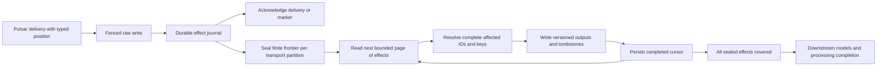

# Bounded analytics within the single-server Pulsar migration

Date: 2026-11-03. Status: proposed amendment; the user approved the direction
and an isolated throwaway proof, not production implementation or filesystem
maintenance. Read with the [Pulsar design](2026-11-03-single-server-pulsar-design.md)
and [qualification evidence](../../pulsar-cdc-assessment.md).

## Purpose

Process arbitrarily long histories as finite, restartable work without making a
single historical day fit in memory or temporary disk. Preserve complete source
selection, corrections, deletions, provenance, erasure fences and truthful
processing status. Intake, durable broker backlog, ClickHouse storage and
analytics each need independent bounds; this amendment addresses analytics and
its causal input evidence. It does not make the whole migration qualified.

The user selected self-hosted Pulsar on the existing machine, requested current
stable versions and approved bounded work plus enforced temporary storage.
Exact schema names and component budgets below are proposals by the author.
No new framework, managed service, permissive decoder, sampling, timeout increase
or silent dropping of work is proposed.

## Approaches

1. **Smaller native dbt time windows alone:** smallest configuration change, but
   one historical hour can still contain unbounded keys or versions. dbt's
   [microbatch strategy](https://docs.getdbt.com/docs/build/incremental-microbatch)
   divides event time, not key cardinality. It cannot establish this requirement.
2. **Bounded durable effects inside the existing serialized analytics job:**
   recommended and consistent with the approved direction. Use native database
   tables, keyset reads and the existing SQL/domain models; add the missing
   causal work manifest, complete-key reconciliation and coverage gate.
3. **Separate stream-processing framework:** introduces another runtime,
   checkpoint system and memory budget. No demonstrated requirement justifies
   replacing the existing analytics worker and domain calculations.

This is a substantial correctness change, not merely adding `LIMIT` to SQL.
The current input discards broker coordinates before analytics, so reliable
enumeration cannot be obtained by changing the hourly batch size alone.

## Proposed flow

### 1. Durable effects, not a global discovery query

Propose a compact ClickHouse effect journal ordered by transport epoch,
partition, delivery position and effect ordinal. Preserve source record identity,
source version/generation, account ownership and affected-key information needed
to recover former and new placements. Store structural processing metadata only,
not another copy of sensor values. PostgreSQL holds the small run/frontier/cursor
state, rather than a PostgreSQL row for every sensor effect.

Pulsar positions must remain typed message IDs with a transport epoch. Legacy
Kafka positions stay separate; archive object/line provenance must not pretend
to reconstruct missing Kafka offsets. Native [Pulsar message IDs and delivery
semantics](https://pulsar.apache.org/docs/5.0.x/concepts-messaging/) describe the
transport boundary, not analytics completion.

Write raw data first, then journal effects durably, then acknowledge the delivery
or processing marker. Replay after failure must regenerate the same effects.
Duplicate journal writes are acceptable only if cursor discovery remains bounded
and output reconciliation is semantically idempotent. Missing journal evidence
must never be interpreted as a completed delivery. No atomic transaction across
Pulsar, PostgreSQL and ClickHouse is assumed.

Bootstrap the journal through bounded source traversal and the required existing
R2 conversion. Enumerate a stable ordered range with `LIMIT N` before locally
deduplicating affected keys; never discover the entire history with global
`DISTINCT` and then apply a limit. A sealed run records transport frontiers plus
the corresponding finite journal boundary. New deliveries beyond that boundary
belong to a later run. An acknowledgement count alone does not enumerate keys.

The proposed consistency contract is current-state reconciliation with causal
coverage, not a historical snapshot at the seal. Reading a later committed
version is permitted; it must not resurrect an earlier state or complete the
later operation without covering that operation's own effects. Each stage emits
durable downstream effects before advancing its cursor. Its coverage frontier
therefore certifies the complete impact closure of covered inputs, including
effects discovered while incorporating newer versions.

Use a vector of required sensor and CDC frontiers per processing operation.
Preserve the existing three processing-marker destinations and dataset dependency
contracts. A PostgreSQL marker must follow its covered canonical transaction
changes through capture, sink visibility, journal effects and required projection
stages before completion is possible. Independently seeing a sensor marker is
insufficient. Missing/misaligned CDC visibility blocks completion rather than
pretending all streams form one total order. Qualifying this barrier for all 18
mappings is prerequisite to retiring PeerDB, not a new CDC framework.

### 2. Complete-key work

Each page bounds discovered effects and distinct reconciliation keys. It does
not discard older source candidates at those keys. Preserve latest version per
source identity before applying deletion state, then the exact existing provider,
reported-versus-estimated and stable-ID selection tuple. Keep nullable provenance
inside the selected tuple. Emit tombstones for keys with no remaining candidates.
These follow the current [dedup model](../../../analytics/models/read_models/deduped_sensor.sql)
and [LIMIT BY semantics](https://clickhouse.com/docs/reference/statements/select/limit-by).

Source IDs supplied by callers cannot be assumed to have immutable timestamps,
providers, channels or owners. A moved identity dirties both its former and new
keys; resolving an old key requires the latest identity state even when that
state is now outside the key. The implementation plan must qualify an ID-leading
lookup/current-placement index and its bounded bootstrap, including changes that
arrive before prior projection completes. The current key-filter-before-latest-ID
query is not proof of this behavior. No permanent duplicate raw values or
compatibility writer is permitted.

Preserve the current global UUID identity namespace: the staging model and
[sink's ID tombstoning](../../../src/metric-stream/clickhouse-sink.ts) resolve by
`id`, while [generated IDs](../../../src/metric-stream/events.ts) hash source
coordinates when no caller ID is supplied. Do not silently reinterpret identity
as `(user, id)` or `(provider, id)`. An ownership change is not permission to
transfer another account's data: both ownership/fence checks must pass, and a
conflicting or unresolvable identity must fail explicitly. Add collision and
ownership-boundary tests before approving the placement index migration.

Activity projections require their own bounded effect expansion: overlapping and
cross-midnight windows, changed membership, activity-only corrections and stale
associations must dirty former output keys as well as current ones. Invalid RR
samples and removed associations require tombstones. The normalized static-input
spike does not qualify these paths.

One pathological key can still have many candidates. Enforced resource limits
must fail that page visibly with its identity/frontier retained. Do not split away
candidates, sample, use `any`, skip the key or raise the limit to claim success.
Handling such a demonstrated case is a new qualification gate.

### 3. Output first, checkpoint last

Retain the existing single serialized analytics queue. After every complete-key
output insert succeeds, persist the next durable cursor. A failure before that
checkpoint replays the page. Versioned outputs must converge without allowing an
older retry to overwrite newer source state. Wall-clock `now64` alone is not that
proof: validate source revision/generation and serialized ownership at publication.

Before a replacement worker writes, establish that its predecessor's server-side
query is terminal; a lost client connection is not proof of termination. Preserve
the existing account-erasure writer barrier and add every journal, cursor and
intermediate output store to its ownership/deletion inventory. Source fences must
be checked at the actual insert boundary, not just when work is scheduled.

Do not mark a model, processing operation or dashboard cache ready until every
sealed effect has successful output coverage and dependent stages have completed.
Extend the existing [processing coordinator](../../../src/processing/analytics-processing.ts)
with that coverage gate. Partial-page progress remains processing, and later
deliveries remain pending even when they affect an already covered key. A bounded
continuation uses the existing queue rather than a second scheduler.

## Physical storage and memory enforcement

The isolated stable-engine counterexample exceeded a 1 MiB per-query temporary
allowance. The upstream [external-sort issue](https://github.com/ClickHouse/ClickHouse/issues/105638)
and [open fix](https://github.com/ClickHouse/ClickHouse/pull/110993) identify sort
scope bypass of query/user accounting. Do not adopt an unreleased patch as the
production fix. Separately qualify the native server-wide cap as defense in depth;
the per-query counterexample does not establish that the server-wide cap fails.
Neither accounting nor sampled free-space polling replaces a physical boundary.

Propose native ext4 project hard quotas for independent persistent owners,
including a dedicated ClickHouse temporary directory. Keep explicit host reserve
and capacity for merges, logs, data, journal and broker/metadata. Exact allocations
must follow aggregate measured workload and recovery/maintenance needs. Query
memory limits, finite concurrency and bounded pages remain necessary inside the
service cgroup; a disk quota does not bound memory.

The existing data filesystem is separate from root and lacks required quota
features. Enabling them requires quiescing every user of that data filesystem and
an ordinary successful unmount; root/SSH can remain available. OCI rescue is not
inherently necessary, but verified independently accessible backups, recovery
instructions and maintenance approval remain prerequisites. Follow installed
tool output and filesystem state rather than promising a universal `e2fsck`
sequence. See [tune2fs feature restrictions](https://man7.org/linux/man-pages/man8/tune2fs.8.html)
and [ext4 quota support](https://docs.kernel.org/admin-guide/ext4.html).

The service must run without quota-bypass capability; a prior isolated test
showed privileged root can bypass project quotas. Startup must fail if the
expected project/mount/limits are absent. Qualify quota exhaustion, partial-file
cleanup, process restart, filesystem remount and reserve preservation. A fixed-size
loop filesystem remains an unselected alternative with mount-order/recovery
costs, not an automatic fallback. No production quota/remount change is authorized
by this amendment.

## Isolated spike and limits of its evidence

The throwaway test uses pinned ClickHouse 26.10.2.103, a 768 MiB container and an
8 MiB kernel-limited tmpfs mounted only at its temporary path. tmpfs consumes
memory and proves a kernel boundary, not production disk throughput or ext4
deployment. An actual UID-101 write hit ENOSPC at exactly 8,388,608 bytes; the
full synthetic query refused a 16,851,247-byte temporary reservation with code
243 against the 8 MiB filesystem. That query failed at ClickHouse's free-space
reservation check, not an observed spill write hitting kernel ENOSPC.

The fixture contains 800,000 normalized versions, 400,000 IDs, 1,000 logical keys,
nullable provenance, reported/estimated candidates and an all-deleted key. The
reference compares every stable output column, excluding volatile refresh version.
The bounded exercise uses 20-effect pages with a 128 MiB query limit and a sealed
1,100-effect frontier; effect 1,101 remains pending. The first page was written
before a deliberate pre-checkpoint failure, then replayed after restarting the
isolated container. All 55 resumed pages completed; the 56 successful executions
had zero page exceptions, peak tracked query memory 11,319,945 bytes and exact
reference payload equality. Cursor reached 1,100 while effect 1,101 remained
pending. See the [full scoped evidence](../../pulsar-cdc-assessment.md#bounded-work-and-physical-boundary-spike),
including setup cgroup pressure and restart-versus-power-loss limits.

Excluded: broker transport, journal construction/sealing, CDC, scalar staging,
activity projection, source mutation after sealing, mutable identity, hot-key
fanout, erasure, power-loss durability, physical quota deployment and whole-host
coexistence. Passing this fixture cannot close those gates.

## Implementation and acceptance boundaries

After amendment approval, write a test-first implementation plan with explicit
review checkpoints. Start with executable effect-journal ordering, missing-write,
duplicate delivery and source-move regressions. Qualify scalar/dedup/activity
stages together before enabling coverage-driven completion. Follow with restart,
erasure race, hot-key/resource rejection and aggregate-load tests. Do not expand
the throwaway file into production code.

Maintain the [current stable release floor](../../pulsar-cdc-assessment.md#current-stable-releases-rechecked).
The existing whole-server memory budget still fails; no reduced ClickHouse ceiling
or combined workload soak has passed. Native R2 conversion/readback, CDC mapping,
physical erasure, consistent recovery and cutover overlap remain required.

Keep analytics-refresh, sync-ride-with-gps and sync-strava paused and the history
sink at zero until their safe restoration gates pass. Preserve existing jobs,
Strava's saved checkpoint, all original R2 archives and the retained rehearsal
backup. Full resync completion still requires every provider gap, strict refresh,
independent served MTB/elevation/site checks and explicit restoration of all four
holds. No deployment or merge is part of this design task.

## Design review

A separate builder review identified three material ambiguities: seal
consistency, identity namespace and CDC completion. This amendment now states
current-state reconciliation with causal impact closure, preserves the existing
global UUID identity contract and requires operation-specific sensor/CDC frontier
coverage. The reviewer found no remaining material question before planning.
The spike also received a separate integrity review; query-log evidence was
subsequently fenced by a durable run token and checked for exception records.
