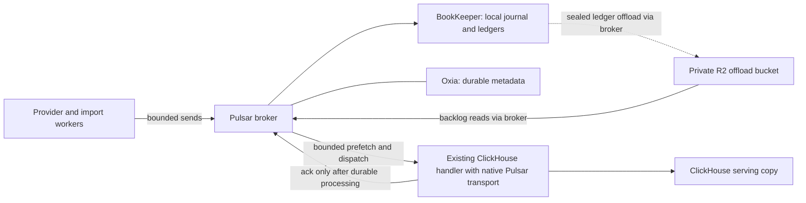

# Single-server Pulsar migration

Date: 2026-11-03. Status: proposed design; implementation and production cutover
are not approved by this document. The user selected self-hosted Pulsar on the
existing server after comparing Pulsar and AutoMQ. No additional machines or
managed messaging service are in scope.

## Purpose and constraints

Decouple historical intake from ClickHouse throughput without allowing either
component to exhaust the shared production filesystem. Preserve acknowledged
events, account-erasure protections, processing evidence, provider checkpoints,
and the existing application data model. Slow or reject intake explicitly when
capacity is exhausted; never silently evict unconsumed records.

Current architecture and incident evidence are in the
[deployment guide](../../../deploy/README.md),
[metric-stream architecture](../../clickhouse-metric-stream.md), and
[incident baseline](../../production-incident-baseline.md). The existing host is
ARM64, with approximately 24 GB RAM and a 150 GiB data filesystem. ClickHouse's
configured memory ceiling is 13 GiB. Existing Redpanda and ClickHouse data already
occupy most of that filesystem. An in-place parallel migration has not been
shown to fit. The approved volume expansion remains blocked by missing OCI
access/state; this design does not require spending approval again or assume
that expansion occurred.

Pulsar does not provide unlimited free intake. R2 storage and requests can incur
charges, and loss of R2 connectivity eventually requires local intake to stop.
See [R2 pricing](https://developers.cloudflare.com/r2/pricing/).

## Approaches and selected direction

1. **Pulsar on the existing server: selected by the user.** Separate broker,
   BookKeeper and metadata-store processes share one host, with R2 offloading.
   This avoids new machines but cannot tolerate loss of the sole storage node.
2. **Pulsar across independent machines: declined.** Offers independent storage
   failure domains at additional cost and operational scope.
3. **AutoMQ: considered and not selected.** Kafka compatibility would reduce
   application migration work, but the user chose Pulsar.

Use native Apache components and the official Node client, not a Kafka protocol
compatibility plugin or a generic JDBC ClickHouse sink. Application integration
is still necessary: the current consumer owns deletion fences and processing
markers that an off-the-shelf JDBC sink does not implement. Reuse that domain
logic rather than developing a new broker, offloader, or ingestion framework.
Pulsar documents its [clients](https://pulsar.apache.org/docs/5.0.x/concepts-clients/)
and [component topology](https://pulsar.apache.org/docs/5.0.x/deploy-docker/).

## Proposed topology

All services remain in the current Swarm deployment, with internal messaging and
admin endpoints. Use one broker, one bookie with ensemble/write/ack quorum 1,
and one persistent Oxia instance with separate namespaces for Pulsar and
BookKeeper. Multiple bookies on this same disk do not create independent failure
domains. Do not deploy the developer standalone bundle as the production
service. Current Apache guidance recommends Oxia for new clusters:
[metadata administration](https://pulsar.apache.org/docs/5.0.x/administration-zk-bk/).

The release candidate to verify is Pulsar 5.0.1. Resolve the newest stable
compatible broker, Oxia and official Node-client releases at implementation time,
pin versions/digests, and validate their ARM64 artifacts and Node 26/native-client
compatibility before adding dependencies. Existing Alpine application images
must not be assumed compatible with the client's native binaries.

## Capacity and backpressure contract

There are three distinct limits; none substitutes for the others:

- **Client memory:** finite pending-send and receiver queues, bounded bytes per
  message and per processing batch, finite concurrent sends, and no unbounded
  application buffering. A failed send must not advance provider completion.
  Use the official client's controls, not a custom buffering service:
  [Node configuration](https://pulsar.apache.org/docs/client-libraries/node-configs/).
- **Broker workload:** explicit namespace backlog quotas using
  `producer_exception`, never `consumer_backlog_eviction`; separate live/history
  subscriptions and dispatch budgets. Backlog bytes are logical work, not an
  accurate measure of physical disk occupancy. Throttling is a workload control,
  not a disk-capacity proof. Configure existing policies documented in
  [namespace administration](https://pulsar.apache.org/docs/5.0.x/admin-api-namespaces/)
  and [dispatch throttling](https://pulsar.apache.org/docs/5.0.x/concepts-throttling/).
- **Physical storage:** enforce independent directory/filesystem budgets for
  BookKeeper, metadata, ClickHouse data/temp/logs, and other persistent services,
  plus an unallocated host reserve. A shared-free-space polling guard alone
  cannot provide this isolation. Evaluate native ext4 project quotas on the
  existing filesystem before selecting exact enforcement commands; no filesystem
  feature, remount, repartitioning or quota mutation is authorized by this doc.
  Linux documents [ext4 quota support](https://kernel.org/doc/html/next/admin-guide/ext4.html).

BookKeeper read-only disk thresholds are a secondary admission safeguard, not a
hard per-directory quota. Garbage collection/compaction also needs temporary
space. If a bookie stops accepting writes, producer failures must remain visible
and resumable. See [BookKeeper disk configuration](https://bookkeeper.apache.org/docs/reference/config/).

Do not invent a fit from current idle memory. Before selecting production
numbers, account for every active service's memory ceiling, JVM heap/direct/native
memory, metadata, kernel/page-cache needs, and a host reserve. Load-test an
aggregate Pulsar budget on ARM64 against the remaining host allowance; leave
ClickHouse's existing cap unchanged unless separately justified. If no allocation
fits, report the existing-server constraint as blocked rather than silently
overcommitting or purchasing more hardware.

No exact throughput, quota size, offload interval or memory allowance is approved
yet. Those values must follow measured event sizes, outstanding work, offload
latency, compaction amplification and the host capacity accounting.

## Offloading, recovery and deletion

Use Apache's S3-compatible offloader with a dedicated private R2 bucket and
least-privilege credentials. Verify required keys in Infisical before any runtime
configuration references them. Test multipart upload, range reads, deletion,
restart recovery and throttling against R2 itself. S3 compatibility is not an
R2-specific certification. Configure ledger rollover, automatic offload and local
deletion lag together; Pulsar can offload sealed segments, not the current open
segment. See [tiered storage](https://pulsar.apache.org/docs/next/tiered-storage-overview/).

**Recovery limitation:** a successful producer send means BookKeeper accepted the
message; it does not mean R2 offloading completed. With one bookie, physical loss
of that disk can lose acknowledged, unoffloaded data. R2 ledgers also need their
metadata to be located and interpreted. No zero-RPO host-loss claim is allowed.
This follows the documented [messaging architecture](https://pulsar.apache.org/docs/5.0.x/concepts-messaging/)
and offload sequence. Crash/restart recovery and full disk-loss recovery must be
tested separately.

Back up metadata and any required local ledger state using a documented,
consistent restore procedure; a periodic live-directory copy is not sufficient
evidence. Restore into an isolated environment and read known records, including
offloaded ones. Determine and expose the measured recoverable boundary/RPO.
If lossless acknowledgment across host loss is a requirement, this proposed
single-bookie topology cannot satisfy it and needs a new user decision.

Native offload objects are opaque broker storage, not the existing gzip JSONL
archive format. Do not point the current archive rewriter at them. Define and
test physical retention/GC of local and offloaded copies, subscription cursors,
quarantine and recovery backups before replacing any archive path. No TTL may
silently acknowledge unprocessed work. Account erasure must fence late writes
immediately and verify eventual physical removal within its existing deadline;
retained shared ledgers can delay that removal. Failure to prove the deadline is
a cutover blocker. Existing legacy JSONL archives retain their current erasure
owner until their approved retirement.

## Application integration

Keep provider-independent event schemas, deterministic record IDs/versions,
delete ordering, provider-generation fences and account-erasure checks. Use
acknowledgment only after successful ClickHouse writes and durable processing
evidence; crash between insertion and acknowledgment must safely replay. Invalid
events are acknowledged only after durable quarantine succeeds. Do not promise
exactly-once inserts merely because a broker offers deduplication.

Replace Kafka-offset assumptions comprehensively. Current processing markers use
`topic_partition Int32` and `marker_offset UInt64`; erasure captures Kafka high/low
watermarks and consumer offsets. Pulsar message IDs must not be squeezed into
Kafka integers. Use typed transport positions, with a durable transport epoch and
Pulsar message-ID representation, in the processing/erasure contracts. Preserve
historical Kafka evidence through a tracked schema migration; avoid permanent
dual writers or compatibility services. Subscription drain, acknowledgment and
physical expiry are separate proofs. Web/mobile continue to receive the existing
server-owned processing state, with parity tests if visible states change.

## Migration and rollback boundaries

1. Preserve the four owned production holds and existing jobs/checkpoints. Record
   fresh health, capacity, archive coverage and exact source ranges before any
   migration. No fresh Strava full-history request is permitted.
2. Run isolated local/ARM64 resource, R2 and failure tests using synthetic data.
   Establish storage enforcement, recovery evidence and the erasure deadline.
3. Inventory retained Redpanda ranges, consumer commits and JSONL archive ranges
   per topic/partition. Prove archive completeness through the sealed cutover
   boundary. Do not equate an earlier zero-lag snapshot with current coverage.
4. Prepare a restartable, bounded transfer of only the verified required ranges
   into Pulsar, preserving payload versions and per-source-partition order, and
   recording source Kafka coordinates separately from new Pulsar message IDs.
   Repeated transfer must be semantically idempotent. Prove the overlap disk/RAM
   budget before starting both brokers; otherwise cutover remains blocked.
5. Quiesce metric-stream writers, capture a final source boundary, finish and
   reconcile transfer, then switch to a single Pulsar writer path. Use the
   canonical deployment workflow; do not manually restore old readers across
   schema boundaries. Kafka offsets are not Pulsar subscription positions.
6. Start bounded ClickHouse consumption and verify processing counts, deletion
   fences, archive/offload readback and public health. Restore each owned hold
   explicitly only when its prerequisites pass. Preserve Strava's 789-ID saved
   continuation and the original Ride with GPS job/window; neither is successful.
7. Remove Redpanda and its obsolete runtime/configuration only after migration,
   retention/erasure, reconciliation and restore evidence pass. Retain required
   backups and the separately preserved rehearsal archive. Rollback before new
   writes may restore the sealed source; after new Pulsar writes, automatic
   rollback to Kafka is prohibited until those writes have a verified recovery
   path. No dual-write window is assumed.

## Acceptance gates

- R2 outage plus continuing input reaches bounded producer rejection without
  dropping acknowledged events or filling the host filesystem.
- Bookie/broker/metadata process restarts, interrupted offloads, disk quota
  exhaustion and ClickHouse failures recover with verified counts and ordering.
- A crash after ClickHouse insertion but before acknowledgment safely replays;
  malformed-event quarantine failure never acknowledges the source record.
- Slow/stopped ClickHouse does not exhaust client memory or broker local storage;
  long-lived backlog remains readable after offloading and local ledger GC.
- Account/provider deletion during backlog replay cannot resurrect records, and
  local/offloaded/archive/backup expiry proofs satisfy existing erasure deadlines.
- Isolated full recovery demonstrates the documented RPO; all steady-state
  resource ceilings plus host reserve fit the existing machine.
- Legacy transfer can restart at every boundary without omissions, and processing
  evidence correctly distinguishes Kafka and Pulsar positions.
- Final all-provider histories, strict analytics refresh, served MTB/elevation
  checks, and restoration of all four holds remain separate incident-completion
  gates. Migrating the broker does not resolve Wahoo's upstream FIT failures.

## Review and remaining decisions

The author reviewed this design against the current consumer, marker schema,
account-erasure drain and deployment configuration; no subagents were used.
Unresolved implementation prerequisites are physical quota feasibility, a proven
host resource allocation, native-client build compatibility, R2 integration,
consistent recovery, physical erasure timing and an overlap migration budget.
Do not declare production readiness while any prerequisite remains unproved.

Next step after design approval: write an implementation plan with explicit
test-first gates and review points. No production changes were made while
preparing this design.
